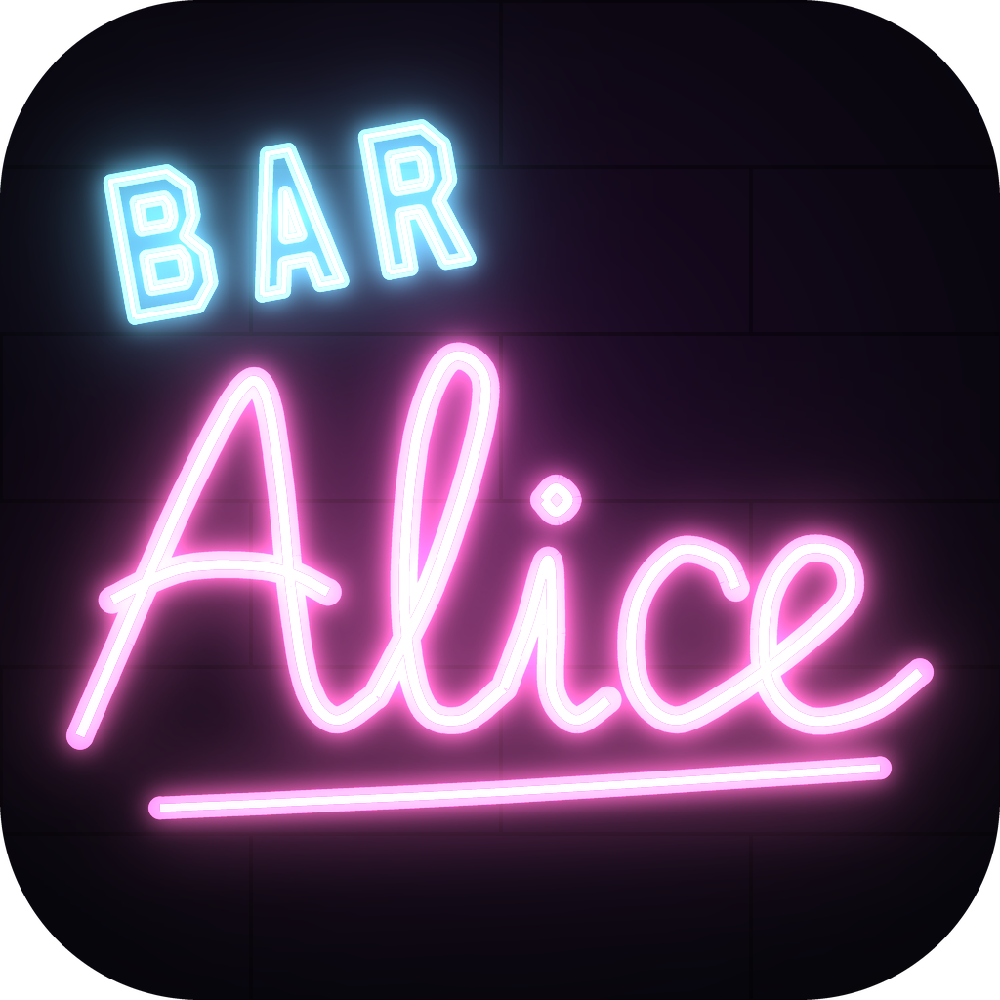

# D-501. 게임 아이콘: 필기체 Alice + 왼쪽 위 BAR

- 날짜: 2026-11-28
- 상태: 확정
- 이슈: #75

## 결정
- 실행파일 · 스팀 아이콘은 **간판 필기체 Alice 다섯 글자 + 밑줄(분홍)**, 왼쪽 위에 **속 빈 블록 글자 BAR(하늘, 왼쪽으로 10도 기울임)**. 바탕은 어두운 벽돌 둥근 사각 타일
- **48px 이하(작업표시줄 · 스팀 목록 16 · 24 · 32 · 48px)는 큰 필기체 A 하나**로 바꿔 그린다 (다섯 글자가 뭉개짐)
- 파일: Windows `Build/Windows/Application.ico` (16 ~ 256), macOS `Build/Mac/Application.icns` + `Build/Mac/Resources/Assets.xcassets/AppIcon.appiconset` (새 Xcode 방식)
- 만드는 법: `python3 tools/neon/make_game_icon.py` (그림 코드 `tools/neon/game_icon_mock.py` 의 `icon_L3`). 미리보기 `DOC/assets/images/game-icon.png`

## 이유
임씨가 시안 세 묶음 + 수정본 12종 중 골랐다. 마티니 · 조커 카드 · 포커 칩 · 성탑 · 토끼 같은 그림보다 간판 글자가 "바 앨리스" 느낌이 산다. 잔은 빼고 (임씨), BAR 는 간판처럼 왼쪽으로 기울였다.

## 대안
- 마티니 잔 / 필기체 A 하나 / 조커 카드 / 카드 속 잔 (1차), 포커 칩 / 카드 성탑 / 카드 부채꼴 / 토끼 회중시계 (2차), 토끼 귀 마티니 / DRINK ME 병 / 모자 쓴 잔 (3차), A + BAR (L2), Alice 비스듬히 (L4): 고르지 않음. 시안 그림은 프로젝트 파일 `game-icon/`
