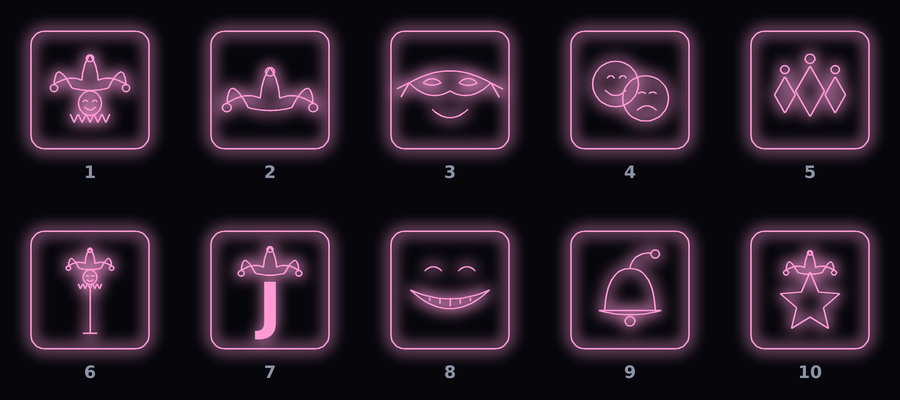
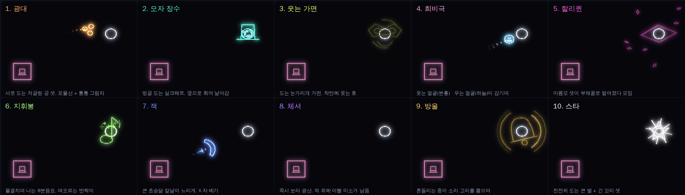
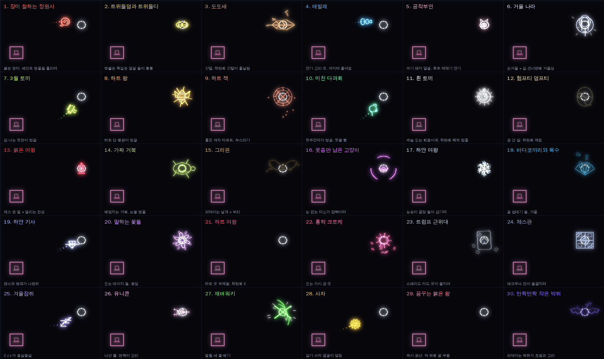

# 15. 화풍 규칙 (웹 프로토타입 네온)

**앞으로 그리는 모든 그림(타워, 적, 아이콘, 캐릭터, UI, 이펙트)은 이 규칙을 따른다.** (2026-11-10 확정)

기준 화면: 웹 프로토타입들 — `DOC/assets/images/prototype-tetris-defense.png`(포탑: 사각 틀 안의 기호), `DOC/assets/images/mock-neon-tower.png`(처음 정한 네온 목업), `DOC/assets/images/prototype-poker-defense.png`.
특징: 가늘고 또렷한 선, **넓고 부드럽게 퍼지는 빛번짐**(웹 캔버스 shadowBlur 느낌), 물체는 **둥근 사각 틀 안에 작은 기호**로 구분.

## 1. 한 줄 요약
어두운 배경 위에, **채우지 않은 한 가지 색 선**이 스스로 빛나는 단순한 도형. 판과 UI는 코드로 그린다. 이미지(텍스처) 파일은 쓰지 않는다. 화면의 모든 그림은 스프라이트다 (D-146): 그림은 코드로 정의해 텍스처 에셋으로 구워 사각형으로 찍는다 (D-139). 카드·조커·이펙트 모양은 에디터 F8 로 `Content/Sprites/T_PDAtlas` 에 미리 굽고 (D-145), 나머지 선은 아틀라스의 선 스프라이트를 늘여 찍는다. 판마다 다른 판 배경만 실행 중에 굽는다. 나이아가라·머티리얼 에셋은 이 화풍을 따르는 이펙트에만 쓴다 (D-092).

> 예외 (D-403): 인게임 화면은 Alice 시안(DOC/assets/images/ui-1120/reference.webp)의 색감을 따른다 — 칠한 카드 · 버튼, 보랏빛 패널, ♣ 파랑. 바뀌지 않는 장식 그림(야자수 · WAVE 간판, 로고, 칵테일 잔)은 시안에서 잘라 낸 PNG(Content/UIArt)를 쓴다.

## 2. 바탕
| 항목 | 값 |
|---|---|
| 배경 | `#06060b` (거의 검정, 살짝 푸른 기) |
| 격자·구획선 | `#788cb4` 6~8% 불투명, 굵기 1 |
| 기준 화면 | 1280 × 720 (크기 값은 모두 이 기준) |

## 3. 선과 빛번짐
- **선만 그린다.** 면을 칠하지 않는다. 예외는 두 가지뿐: 영역 강조용 아주 옅은 채움(같은 색 7%), 글자 뒤 어두운 바탕(배경색 88%).
- 한 물체 = **한 가지 색**. 강조할 때만 가운데에 흰 심을 더한다 (레이저 등).
- 빛번짐은 넓고 옅게 퍼지게 (웹 캔버스 `shadowBlur` 8~18 과 같은 느낌). 언리얼 Slate 에는 블룸이 없으므로 같은 선을 네 겹으로 그린다:

| 겹 | 굵기 | 불투명도 |
|---|---|---|
| 가장 바깥 번짐 | 기본 굵기 × 10 | 4% |
| 바깥 번짐 | 기본 굵기 × 6 | 7% |
| 안쪽 번짐 | 기본 굵기 × 3.2 | 14% |
| 심 | 기본 굵기 × 0.8 | 100% |

- 기본 굵기: 보통 1.5~2.0, 강조 2.0~2.4, 보조 UI 선 1.0. **심은 가늘고 또렷하게**, 빛은 넓게.
- 모서리는 둥글게 (반지름 6~12). 곡선은 베지어·매개변수 곡선을 잘게 나눈 꺾은선으로.

## 4. 색
| 쓰임 | 색 |
|---|---|
| ♠ 스페이드 | `#7fb8ff` 파랑 |
| ♥ 하트 | `#ff6a8a` 빨강 |
| ♦ 다이아 | `#ffd96a` 노랑 |
| ♣ 클로버 | `#46a0ff` 파랑 (D-403, 예전 초록 → 얼음 하늘색) |
| 조커·와일드·특수 | `#ff9ad5` 분홍 / `#ffffff` 흰색 |
| UI 기본 강조 | `#7fd6ff` 하늘 |
| 점수·보상·금 | `#ffd96a` |
| 좋음·통과 | `#9cffb0` |
| 위험·실패 | `#ff6a6a` |
| 본문 글자 / 보조 / 흐림 | `#cfd8e6` / `#8a94a6` / `#5f6878` |
| 적 | 보통 `#e8f0ff`, 빠름 `#ffa86a`, 탱크 `#c49aff`, 방패 `#9fc3e8`, 분열 `#ff9ad5`, 재생 `#b6ff6a` |
| 보스 (D-112) | 방패 거인 `#9fc3e8`, 분열 군주 `#ff9ad5`, 재생 왕 `#b6ff6a`, 돌진 기사 `#ffa86a`, 소환사 `#c49aff`, 유령 `#cfe4ff`, 군단장 `#ffd96a`, 분노 거인 `#ff6a6a`, 공간 도약자 `#7fd6ff`, 흡수자 `#e07aff`, 수호자 `#a8f0ff`, 저주술사 `#9a7aff`, 파괴자 `#ffcf5a` |

| 족보 (장판·테두리·패널) | 로열 `#fff4d6` (판 위 장판은 무지개로 돎), 파이브 `#ffd96a`, 스트레이트 플러시 `#ff9ad5`, 포카드 `#ff6a6a`, 풀하우스 `#ffa86a`, 플러시 `#b48cff`, 스트레이트 `#6a8cff`, 트리플 `#9cffb0`, 투 페어 `#7fd6ff`, 원 페어 `#cfd8e6` |

새 색이 필요하면 위 색과 밝기를 맞춘 파스텔 네온으로 고르고 이 표에 더한다.

**족보 장판** (D-099): 족보가 생긴 칸 바닥에 족보 색으로 옅은 채움 13% + 45도 가는 빗금(8px 간격, 30%) + 빛나는 테두리. 카드를 나눠 쓰는 족보는 한 겹(5px) 안쪽으로 겹쳐 깐다. 미리보기 `python3 tools/neon/neon.py floors 출력.png`.

## 5. 모양 (캐릭터·아이콘 그리는 법)
- **선 몇 개로 알아볼 수 있는 실루엣**이 먼저다. 세부 묘사, 명암, 질감은 넣지 않는다.
- 판 위 크기(반지름 약 22px)로 줄여도 알아볼 수 있어야 한다. 작게 그려서 확인한다.
- 좌우 대칭을 기본으로. 선 굵기는 한 그림 안에서 같게.
- 얼굴은 동그라미 하나 + 눈 두 개(짧은 호) + 입 하나(호). 코·귀·머리카락은 그리지 않는다.
- 겹치는 도형은 바깥 테두리 하나로 합친다 (예: 클로버 잎 셋). 안쪽 선이 글자를 가로지르지 않게.
- 숫자·글자는 도형 안쪽 비어 있는 자리에, 같은 색 굵은 글꼴로.
- **판 위 물체(타워·포탑·건물)는 둥근 사각 틀(칸의 약 80%, 모서리 반지름 = 틀 반 너비의 22%) 안에 기호를 넣는다.** 강조(족보·강화) 상태는 틀 안을 같은 색 8~13%로 옅게 채우고 숨쉬게 한다.
- 예시:
  - 타워: 틀 + 위쪽에 숫자 + 아래쪽에 작은 무늬 기호. 와일드는 틀 + 별
  - 카드 무늬 기호: 스페이드 = 뒤집은 하트 + 꼬리, 하트 = 하트 곡선, 다이아 = 마름모, 클로버 = 잎 셋 테두리 + 꼬리
  - 조커: 방울 달린 세 갈래 모자(양옆 뿔은 아래로 처짐) + 웃는 얼굴 + 뾰족한 옷깃
  - 적: 원, 삼각형, 육각형 등 기본 도형에 특징 하나(방패 막대, 십자, 겹친 원)

## 6. 움직임과 이펙트
| 이펙트 | 규칙 |
|---|---|
| 파티클 | 작은 정사각형(2~3px) + 그 4배 크기 옅은 번짐(15%). 줄무늬 파티클은 속도 방향으로 짧은 선 |
| 고리(충격파) | 반지름이 빠르게 커졌다 느려짐(ease-out), 투명해지며 사라짐 |
| 레이저 | 색 선 + 가운데 흰 심, 0.12초 |
| 숨쉬기 | sin 으로 밝기·크기 ±6~20% |
| 등장 | 1.5배에서 1배로 0.3초 |
| 화면 번쩍임 | 최대 45% 불투명, 0.3~0.6초 |
| 화면 흔들림 | 최대 14px, 0.6초 이하 |
| 나이아가라 | 월드 이펙트 층(Slate 판 뒤)에서 재생. 입자는 한 색 + 흰 심, 발광(HDR) 색으로 블룸을 받게, 텍스처 없이 기본 스프라이트·리본. 에셋은 `Content/FX/` 에 `NS_` 이름 |

## 7. 하지 않는 것
- 면 채우기, 그라데이션, 질감, 사진, 픽셀 아트, 수채화, 손그림 느낌
- 한 물체에 여러 색 (흰 심 제외)
- 외부 이미지·텍스처 파일 (판과 UI 그림은 코드. 코드로 그려 실행 중에 구운 텍스처는 됨 — D-139. 나이아가라·머티리얼 에셋은 이펙트에만, 텍스처 없이 이 화풍대로 — D-081)
- 가는 선을 배경 없이 글자 위에 겹치기

## 8. 도구
- 언리얼: `Source/ProjectB/PDBoardDraw.h` 의 `FCanvas` (Glow, Lines, Shape, CardShape, Badge ...)가 이 규칙대로 그린다. 새 그림은 여기에 함수로 더한다.
- 미리보기: `tools/neon/neon.py` — 언리얼 빌드 없이 같은 화풍으로 PNG를 그려 확인한다 (`towers`, `suits`, `joker`). 새 그림은 여기서 먼저 그려 보고 언리얼로 옮긴다.

## 9. 저장된 그림: 조커 10종 (2026-11-10)

사용자가 10종 모두 마음에 들어 함. **조커 포탑 10종의 모양으로 사용** (DOC/design/14 13절, 언리얼 `FCanvas::JokerArt`).
그림 코드: `tools/neon/neon.py` 의 `joker_cards()` (j1~j10). 미리보기: `python3 tools/neon/neon.py jokers 출력.png`

| 번호 | 함수 | 그림 |
|---|---|---|
| 1 | j1 | 광대 머리: 방울 세 갈래 모자 + 웃는 얼굴 + 뾰족한 옷깃 |
| 2 | j2 | 광대 모자만 (방울 셋) |
| 3 | j3 | 웃는 가면: 눈가리개 + 미소 + 양옆 끈 |
| 4 | j4 | 희비극 가면: 웃는 얼굴과 우는 얼굴이 겹침 |
| 5 | j5 | 할리퀸 마름모 셋 + 방울 |
| 6 | j6 | 광대 지팡이: 막대 끝에 작은 광대 머리 |
| 7 | j7 | 광대 모자를 쓴 J 글자 |
| 8 | j8 | 체셔 미소: 이빨 보이는 큰 웃음 + 웃는 눈 |
| 9 | j9 | 방울 하나 + 위로 말린 모자 끝 |
| 10 | j10 | 광대 모자를 쓴 별 |

공통: 둥근 사각 틀(반 너비 0.98R, 모서리 0.22R) 안, 분홍 `#ff9ad5`, 좌표는 틀 중심 기준 R 단위. 언리얼로 옮길 때는 같은 좌표로 `FCanvas` 함수를 만든다.

## 10. 발사체 (2026-11-10)

무늬마다 다른 발사체를 같은 화풍(채우지 않은 한 색 가는 선 + 넓은 빛번짐)으로 그린다. 미리보기 `python3 tools/neon/neon.py shots 출력.png`.

| 무늬 | 모양 |
|---|---|
| ♠ | 레이저 한 줄 + 양끝 고리 |
| ♥ | 미사일: 뾰족한 몸통 + 뒤로 꺾인 날개 둘 + 작은 동그라미 연기 |
| ♦ | 짧은 줄 탄환 |
| ♣ | 동그라미 구체 안 눈꽃(선 셋) + 작아지는 동그라미 꼬리 |
| ★ | 별 + 짧은 꼬리 선 |
| 조커 | 조커마다 다름 → 아래 10-1 |

### 10-1. 조커 발사체 40종 (D-488, 2026-11-27)

조커 10종 + 상위 조커 30종은 발사체가 저마다 다르다: **실루엣(모양) + 색 + 움직임 + 착탄**.
- 한 물체 한 색 + 흰 심 (희비극만 분홍 · 하늘 두 색). 반지름 약 11px (판 위에서 한눈에 읽히게).
- 상위 조커는 첫 재료 조커 무리의 **움직임**을 물려받고, 모양 · 색은 자기 인물 상징. 레시피가 바뀌어도 그림은 조커 번호에 묶여 그대로.
- 착탄: 자기 실루엣이 커지며 사라지는 **도장** + 무리마다 다른 파편 (색종이, 깃털, 거품, X 베기 …).
- 그림만 바꾼다. 속도 · 피해 · 유도는 규칙 그대로 (움직임은 화면 오프셋, 닿는 순간 0).
- 코드: `Source/ProjectB/PDJokerShots.cpp` (표 `GJsDefs`, 모양 `JsShape`). 시안: `python3 tools/neon/joker_shots_mock.py 출력폴더` (움직이는 GIF, 같은 모양 · 색 · 움직임).

| 번호 | 조커 | 색 | 움직임 | 모양 · 착탄 |
|---|---|---|---|---|
| 1 | 광대 | `#ffa45a` | 포물선 | 서로 도는 저글링 공 셋, 포물선 + 통통 그림자 |
| 2 | 모자 장수 | `#4ff0c8` | 휘며 빙글 | 빙글 도는 실크해트, 옆으로 휘어 날아감 |
| 3 | 웃는 가면 | `#f2ff6a` | 직선 빙글 | 도는 눈가리개 가면, 착탄에 웃는 호 |
| 4 | 희비극 | `#ff9ad5` | 두 줄 감기 | 웃는 얼굴(분홍) · 우는 얼굴(하늘)이 감기며 |
| 5 | 할리퀸 | `#ff5ad2` | 부채꼴 셋 | 마름모 셋이 부채꼴로 벌어졌다 모임 |
| 6 | 지휘봉 | `#a6ff7a` | 물결 | 물결치며 나는 8분음표, 떠오르는 반짝이 |
| 7 | 잭 | `#6a8cff` | 느린 베기 | 큰 초승달 칼날이 느리게, X 자 베기 |
| 8 | 체셔 | `#b77aff` | 즉시 광선 | 즉시 보라 광선, 적 위에 이빨 미소가 남음 |
| 9 | 방울 | `#ffd25a` | 소리 고리 | 흔들리는 종이 소리 고리를 뿜으며 |
| 10 | 스타 | `#ffffff` | 혜성 | 천천히 도는 큰 별 + 긴 꼬리 셋 |
| 상위 1 | 장미 칠하는 정원사 | `#ff6a5a` | 포물선 | 붉은 장미, 페인트 방울을 흘리며 |
| 상위 2 | 트위들덤과 트위들디 | `#ffe45a` | 포물선 | 맞붙은 똑같은 얼굴 둘이 통통 |
| 상위 3 | 도도새 | `#e6b27a` | 포물선 | 깃털, 착탄에 깃털이 흩날림 |
| 상위 4 | 애벌레 | `#5ab4ff` | 포물선 | 연기 고리 셋, 커지며 흩어짐 |
| 상위 5 | 공작부인 | `#ffb4c8` | 포물선 | 아기 돼지 얼굴, 후추 재채기 연기 |
| 상위 6 | 거울 나라 | `#dfe6ff` | 포물선 | 손거울 + 길 건너편에 거울상 |
| 상위 7 | 3월 토끼 | `#c8ff5a` | 휘며 빙글 | 김 나는 찻잔이 빙글 |
| 상위 8 | 하트 왕 | `#ffbe5a` | 휘며 빙글 | 하트 단 왕관이 빙글 |
| 상위 9 | 하트 잭 | `#ff9a7a` | 휘며 빙글 | 훔친 격자 타르트, 부스러기 |
| 상위 10 | 미친 다과회 | `#6affb0` | 휘며 빙글 | 찻주전자가 빙글, 찻물 튐 |
| 상위 11 | 흰 토끼 | `#ffffff` | 휘며 빙글 | 바늘 도는 회중시계, 착탄에 째깍 멈춤 |
| 상위 12 | 험프티 덤프티 | `#fff0b0` | 직선 빙글 | 금 간 알, 착탄에 깨짐 |
| 상위 13 | 붉은 여왕 | `#ff3a4a` | 직선 빙글 | 체스 퀸 말 + 달리는 잔상 |
| 상위 14 | 가짜 거북 | `#b8d870` | 직선 빙글 | 헤엄치는 거북, 눈물 방울 |
| 상위 15 | 그리핀 | `#e0b860` | 직선 빙글 | 퍼덕이는 날개 + 부리 |
| 상위 16 | 웃음만 남은 고양이 | `#e070ff` | 직선 빙글 | 눈 없는 미소가 깜빡이며 |
| 상위 17 | 하얀 여왕 | `#cfeaff` | 두 줄 감기 | 눈송이 결정 둘이 감기며 |
| 상위 18 | 바다코끼리와 목수 | `#4ab8e8` | 두 줄 감기 | 굴 껍데기 둘, 거품 |
| 상위 19 | 하얀 기사 | `#a8b8ff` | 두 줄 감기 | 랜스와 방패가 나란히 |
| 상위 20 | 말하는 꽃들 | `#d8a0ff` | 두 줄 감기 | 도는 데이지 둘, 꽃잎 |
| 상위 21 | 하트 여왕 | `#ff4a7a` | 부채꼴 셋 | 하트 셋 부채꼴, 착탄에 X |
| 상위 22 | 홍학 크로케 | `#ff6aa0` | 부채꼴 셋 | 도는 가시 공 셋 |
| 상위 23 | 트럼프 근위대 | `#c8d0e0` | 부채꼴 셋 | 스페이드 카드 셋이 줄지어 |
| 상위 24 | 체스판 | `#9fb0d0` | 물결 | 체크무늬 칸이 물결치며 |
| 상위 25 | 겨울잠쥐 | `#b0a0ff` | 물결 | Z z z 가 둥실둥실 |
| 상위 26 | 유니콘 | `#ffc0f0` | 물결 | 나선 뿔, 반짝이 꼬리 |
| 상위 27 | 재버워키 | `#6aff5a` | 느린 베기 | 발톱 세 줄 베기 |
| 상위 28 | 사자 | `#ffc83a` | 느린 베기 | 갈기 사자 얼굴이 덮침 |
| 상위 29 | 꿈꾸는 붉은 왕 | `#ff7a9a` | 즉시 광선 | 즉시 광선, 적 위에 꿈 구름 |
| 상위 30 | 반짝반짝 작은 박쥐 | `#8a6aff` | 소리 고리 | 퍼덕이는 박쥐가 초음파 고리 |
