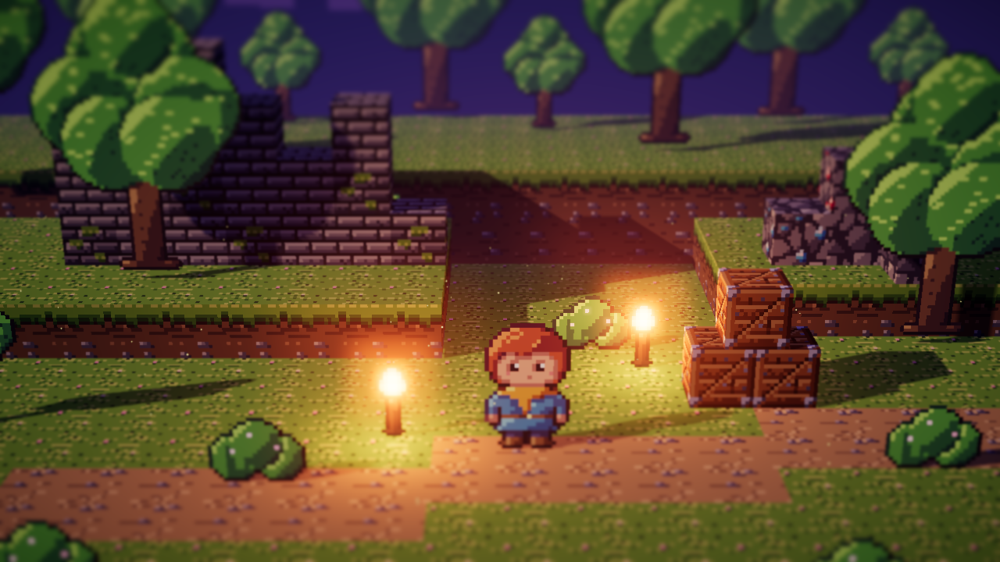

# ProjectB

언리얼 엔진 기반 PC 게임 프로젝트입니다. Windows와 macOS를 지원하며 Steam으로 출시합니다.

## 문서

| 문서 | 내용 |
|---|---|
| [docs/00-project-charter.md](docs/00-project-charter.md) | 프로젝트 개요, 확정 사항, 미결정 사항 |
| [docs/01-game-design.md](docs/01-game-design.md) | 게임 기획서 (GDD) |
| [docs/02-technical-plan.md](docs/02-technical-plan.md) | 기술 계획: 엔진, 플랫폼, 빌드, 협업 규칙 |
| [docs/03-steam-release.md](docs/03-steam-release.md) | Steam 출시 계획과 체크리스트 |
| [docs/04-roadmap.md](docs/04-roadmap.md) | 마일스톤과 일정 |
| [docs/05-decision-log.md](docs/05-decision-log.md) | 의사결정 기록 |
| [docs/06-concept-candidates.md](docs/06-concept-candidates.md) | 콘셉트 후보 비교와 추천 |
| [docs/07-art-pipeline.md](docs/07-art-pipeline.md) | 아트 파이프라인과 픽셀 아트 생성 방식 |

## 도구

| 경로 | 내용 |
|---|---|
| `tools/pixelart/` | 픽셀 아트 생성 스크립트 (Python, Pillow) |
| `tools/preview/` | HD-2D 3D 미리보기 렌더러 (three.js, 헤드리스 Chromium) |

## 상태

기획 단계. 문서가 먼저 확정된 뒤 언리얼 프로젝트 골격을 추가합니다.
