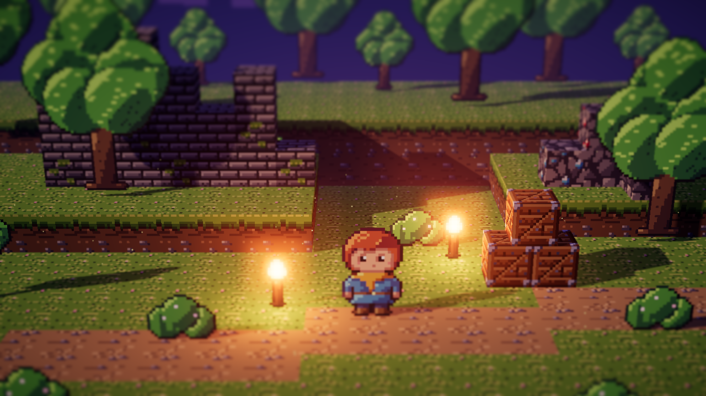
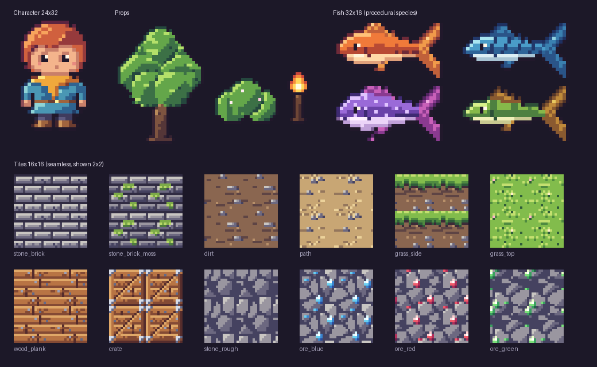

# 07. 아트 파이프라인

최종 수정: 2026-11-05

## 1. 원칙

- 스타일: 한국형 HD-2D. 픽셀 아트 스프라이트를 3D 공간에 배치하고, 언리얼의 동적 조명, 피사계 심도, 블룸으로 분위기를 만든다. 소재는 한국 전통 건축, 의복, 설화에서 가져온다.
- 제작자: 모든 아트를 Claude가 만든다. 손으로 그리는 대신 코드로 픽셀을 생성한다.
- 생성 코드는 저장소의 `tools/pixelart/`에 두고, 같은 코드를 다시 실행하면 같은 결과가 나오게 한다 (시드 고정).
- 색은 명암 단계마다 색조를 튼 4단계 램프만 쓴다. 외곽선은 검정 대신 재질의 어두운 톤을 쓴다 (sel-out).
- 명암은 광원(왼쪽 위) 기준으로 자동 계산하고, 눈과 하이라이트 같은 세부만 손으로 얹는다.
- HD-2D는 조명과 후처리가 화면 품질의 큰 몫을 담당한다. 그래서 개별 에셋은 단순해도 된다.

## 1.1 아트 방향: 한국형 HD-2D

HD-2D 기법에 한국 전통 소재를 입힌다. 화면만 보고도 한국적인 게임이라는 것이 전달되는 것이 목표다.

### 공간과 건축
| 분류 | 소재 |
|---|---|
| 건축 | 한옥 (기와집, 초가집), 기와 지붕선, 처마, 대청마루, 툇마루, 창호지 문살 |
| 마을 | 돌담길, 장독대, 우물, 정자, 성황당, 서낭나무, 장승, 솟대 |
| 궁궐과 사찰 | 단청, 홍살문, 석탑, 석등, 일주문 |
| 자연 | 소나무, 대나무숲, 매화, 진달래, 계곡, 폭포, 안개 낀 산수 |
| 지하와 던전 | 고분, 폐광, 동굴 사당, 무너진 산성 |

### 사람과 사물
| 분류 | 소재 |
|---|---|
| 의상 | 한복 (저고리, 치마, 두루마기, 도포), 갓, 댕기, 전립 |
| 소품 | 청사초롱, 호롱불, 부채, 탈, 엽전, 부적, 활과 환도 |
| 음식과 생활 | 장독, 떡, 가마솥, 지게, 짚신 |

### 요괴와 몬스터
한국 설화와 민속에서 가져온다. RPG나 전투가 있는 콘셉트라면 몬스터 설계의 기본 출처가 된다.

| 분류 | 예시 |
|---|---|
| 도깨비 계열 | 도깨비, 외다리 도깨비, 도깨비불 |
| 짐승 요괴 | 구미호, 불가사리, 이무기, 해태 (수호 또는 보스) |
| 귀신 | 처녀귀신, 달걀귀신, 물귀신 |
| 사물 요괴 | 오래된 물건이 변한 요괴 (빗자루, 짚신, 장독 등) |

### 색
- 단청과 오방색(청, 적, 황, 백, 흑)을 강조색으로 쓴다. 바탕은 나무, 흙, 기와의 차분한 색으로 두고 강조색은 아낀다.
- 한지의 따뜻한 미색과 먹색을 UI의 기본 톤으로 검토한다.
- 공용 팔레트에 단청 램프(녹청, 주홍, 황토, 군청)와 기와 램프를 추가한다.

### 조명과 분위기
- 청사초롱과 호롱불의 따뜻한 점광원
- 달빛 아래 푸른 밤, 노을 진 기와 지붕
- 산수화 같은 안개와 원경 겹침

### 주의할 점
- 중국풍, 일본풍과 섞이지 않게 한다. 기와 지붕의 곡선, 단청 문양, 의복 형태는 한국 양식을 기준으로 확인한다. 예를 들어 도리이(일본 신사 문)나 중국식 붉은 기둥 일색은 피한다.
- 전통 소재를 희화화하거나 고정관념으로 쓰지 않는다.
- 시대 배경(조선, 삼국, 가상의 한국풍 세계)은 기획에서 정한다.

## 2. 샘플

### 2.1 HD-2D 미리보기 (3D 렌더링)



픽셀 텍스처를 입힌 블록, 세워 둔 스프라이트, 노을 직사광과 횃불 점광원, 실시간 그림자, 틸트 시프트, 블룸, 색 보정을 적용한 실제 3D 렌더링입니다. `tools/preview/`의 three.js 렌더러로 만들었고, 언리얼에서도 같은 구성으로 구현합니다.

### 2.2 에셋 시트



`tools/pixelart/sample_sheet.py`로 생성. 현재 샘플은 품질 검증용 범용 소재이고, 실제 에셋은 1.1의 한국형 방향으로 제작한다.

## 3. 제작 방식별 역량

| 에셋 종류 | 방식 | 품질 기대치 | 비고 |
|---|---|---|---|
| 타일, 블록 텍스처 | 절차 생성 | 높음 | 변형을 무한히 만들 수 있음. 가장 강한 영역 |
| 소품 (상자, 광석, 아이템) | 절차 생성 + 픽셀 맵 | 높음 | |
| 아이콘, UI 요소 | 픽셀 맵 + 절차 생성 | 높음 | |
| 수집 대상 변형 (물고기, 광석, 보석) | 형태 템플릿 + 팔레트, 무늬 조합 | 높음 | 종류 수를 늘리기 쉬움 |
| 단순 캐릭터, 탈것 | 픽셀 맵 직접 작성 | 중간 | 16x24 ~ 32x32 크기 권장 |
| 캐릭터 애니메이션 | 프레임별 재질 맵 | 중간 | 4방향 걷기 3프레임 정도는 가능. 캐릭터 수와 동작 종류가 늘수록 부담이 급증 |
| 이펙트 (파편, 먼지, 불꽃, 빛) | 언리얼 Niagara 파라미터 | 높음 | 스프라이트보다 파티클로 처리 |
| 3D 배경 지형 | 큐브와 단순 메시 + 픽셀 텍스처 | 중간 ~ 높음 | 블록 조립 방식이 유리 |
| 스팀 캡슐, 키 아트 | 게임 에셋 조합 + 타이포그래피 | 중간 | 일러스트 수준은 어려움. 출시 전 리스크로 관리 |

## 4. 기획에 주는 제약

1. 캐릭터 수와 애니메이션 동작 수를 최소화한다. 사람 캐릭터보다 탈것, 기계, 물체가 주인공인 기획이 유리하다.
2. 콘텐츠 분량은 절차 생성 변형(타일, 아이템, 수집 대상)으로 늘린다.
3. 시각적 매력은 조명, 파티클, 후처리로 만든다. 어두운 공간과 광원이 있는 장면이 특히 유리하다.

## 5. 규격

| 항목 | 값 |
|---|---|
| 기본 타일 크기 | 16x16 픽셀 |
| 캐릭터, 탈것 | 16x24 ~ 32x32 픽셀 |
| 팔레트 | 프로젝트 공용 팔레트 1개 (32~48색), 확정 후 `tools/pixelart/palette.py`로 관리 |
| 출력 형식 | PNG, 투명 배경, 스프라이트 시트는 그리드 정렬 |
| 언리얼 텍스처 설정 | 필터 Nearest, 압축 UserInterface2D(RGBA) 또는 무압축, 밉맵 없음, sRGB 켬 |
| 스프라이트 단위 | Pixels Per Unit 고정, 확정 후 기록 |

## 6. 도구

| 경로 | 역할 |
|---|---|
| `tools/pixelart/palette.py` | 공용 팔레트 (재질별 4단계 램프) |
| `tools/pixelart/spritekit.py` | 재질 맵 기반 자동 명암, 색 있는 외곽선, 덧칠 |
| `tools/pixelart/hero.py`, `props.py`, `fish.py`, `tiles.py` | 에셋 정의 |
| `tools/pixelart/export.py` | 전체 에셋을 `tools/pixelart/out/`에 PNG로 출력 |
| `tools/pixelart/sample_sheet.py` | 문서용 샘플 시트 생성 |
| `tools/preview/` | three.js HD-2D 미리보기 렌더러 (헤드리스 Chromium) |

실행 방법:

```bash
python3 tools/pixelart/export.py
```

```bash
cd tools/preview && npm install && node render.mjs
```

## 7. 작업 흐름

1. Claude가 `tools/pixelart/`에 생성 코드를 작성하고 PNG를 출력한다.
2. 출력 PNG와 3D 미리보기 렌더링으로 확인하고 수정을 반복한다.
3. PNG를 `Content/ProjectB/Art/` 아래로 가져온다. 가져오기와 텍스처 설정은 언리얼 Python 스크립트로 자동화한다.
4. 언리얼 에디터 안에서의 최종 확인은 개발자가 직접 한다. Claude의 작업 환경에는 언리얼 에디터가 없다.
5. 피드백을 받아 생성 코드를 수정하고 다시 출력한다.
