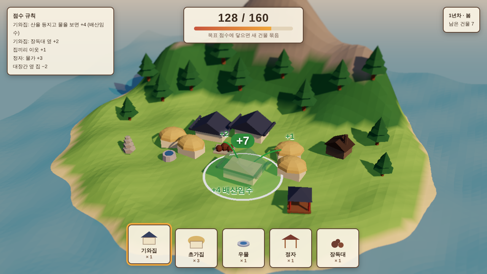
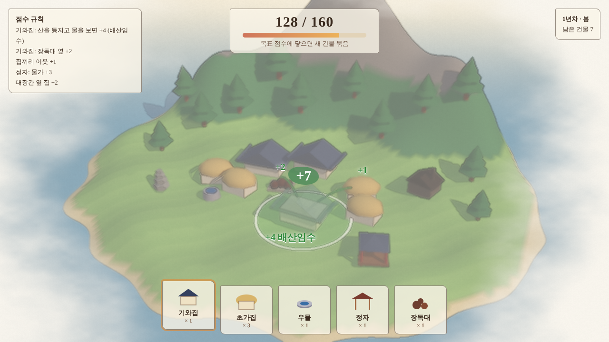
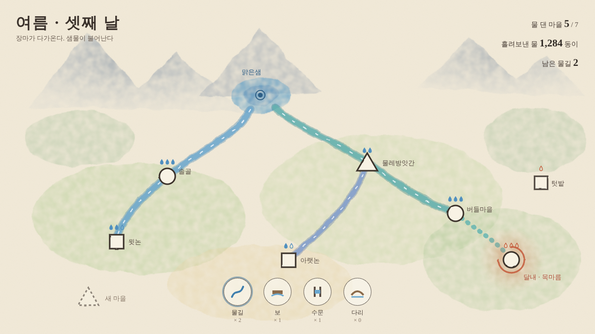
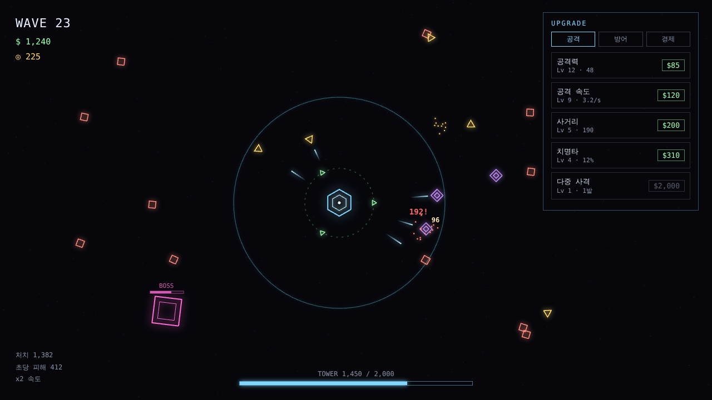
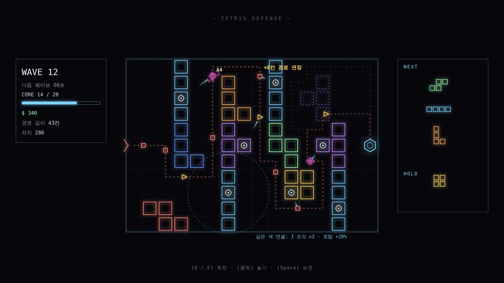
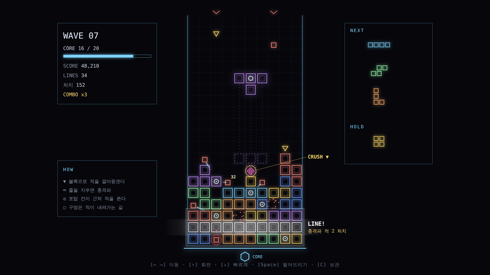

# 08. 도형 기반 게임 콘셉트 검토

최종 수정: 2026-11-05
상태: 화풍 확정 (얇은 선 네온 미니멀). 장르 검토 중

## 1. 새 조건

| 조건 | 내용 |
|---|---|
| 아트 | 기본 도형(정육면체, 원기둥, 원뿔, 구, 원, 선)과 색, 조명, 파티클, 후처리만 쓴다. 캐릭터 애니메이션과 일러스트 없음 |
| 유지되는 조건 | 언리얼, Windows와 macOS, Steam, 싱글플레이, 1인 개발, 2,000원 ~ 5,000원, 반복성, 뱀서류와 중복 회피 |

도형만 쓰면 Claude가 아트를 거의 전부 코드로 만들 수 있다. 언리얼의 조명, Niagara 파티클, 머티리얼로 단순한 도형을 고급스럽게 보이게 하는 것이 아트의 핵심이 된다.

## 2. 후보

### G1. 배치 점수 퍼즐
- 피치: 도형 블록 건물을 섬이나 마을에 하나씩 놓는다. 주변 배치에 따라 점수가 나고, 점수가 차면 다음 건물 묶음을 받는다
- 레퍼런스: Islanders, Dorfromantik
- 반복: 판마다 지형과 건물 묶음이 무작위. 최고 점수 경쟁
- 도형 아트: 지붕은 삼각기둥, 탑은 원기둥, 나무는 원뿔. 노을과 그림자로 분위기를 낸다
- 차별화 아이디어: 한국 마을을 도형으로 짓고, 풍수를 점수 규칙으로 쓴다 (배산임수: 뒤에 산, 앞에 물이면 보너스)
- 위험: 코지 건설 장르는 경쟁작이 많다

화면 목업 (`tools/preview/mock-placement.html`로 렌더링). 산을 등지고 바다를 바라보는 섬에 도형 한옥 마을을 짓는 장면이다. 가운데 반투명 기와집이 지금 놓으려는 건물이고, 원 안의 이웃과 지형에 따라 +7점이 미리 계산되어 보인다. 아래 카드는 받은 건물 묶음, 위는 다음 묶음까지 남은 점수다.

### G2. 흐름 연결 퍼즐
- 피치: 점점 늘어나는 도형 정류장을 선으로 이어 승객 흐름을 감당한다. 감당 못 하면 판이 끝난다
- 레퍼런스: Mini Metro, Mini Motorways
- 반복: 판마다 지도와 수요가 무작위. 버틴 시간과 수송량 경쟁
- 도형 아트: 원, 사각형, 삼각형 정류장과 선. 평면 위주라 아트 부담이 가장 작다
- 차별화 아이디어: 수로, 파발, 전력망처럼 다른 흐름을 다룬다
- 위험: 평면 그래픽이라 언리얼 조명을 살릴 여지가 작다

### G3. 영역 점령 전략
- 피치: 원 모양 거점에서 빛나는 점 유닛을 보내 상대 거점을 빼앗는다. 한 판 3~10분
- 레퍼런스: Galcon, Auralux
- 반복: 무작위 지도, AI 상대, 단계별 도전
- 도형 아트: 원과 수천 개의 빛 점. Niagara 파티클로 화려하게 만들 수 있다
- 위험: 오래된 장르라 대중성은 중간. AI 설계가 재미를 좌우한다

### G4. 미니멀 자동화
- 피치: 도형을 자르고, 칠하고, 합쳐서 요구받은 모양을 컨베이어로 납품한다
- 레퍼런스: shapez
- 반복: 목표 단계 진행, 샌드박스
- 도형 아트: 도형 자체가 게임 재료라 테마와 아트가 일치한다
- 위험: 시스템이 많고 콘텐츠 분량이 커서 저가 1인 게임으로는 무겁다

### G5. 도형 쌓기 물리
- 피치: 떨어지는 도형을 쌓아 무너지지 않는 탑을 높이 올린다
- 레퍼런스: Tricky Towers의 싱글 모드
- 반복: 일일 도전, 최고 높이 경쟁
- 도형 아트: 도형과 물리 연출
- 위험: 깊이가 얕아 금방 질릴 수 있다

### G6. 기하학 회피 액션
- 피치: 음악에 맞춰 몰려오는 도형 패턴을 피한다
- 레퍼런스: Super Hexagon, Just Shapes & Beats
- 반복: 실력 숙달, 최고 기록
- 위험: 음악이 게임의 절반이라 곡 조달이 큰 비용이다

## 3. 비교

| 후보 | 반복성 | 1인 완성 | 도형 아트 적합 | 언리얼 적합 | 경영, 전략 성향 | 시장성 | 종합 |
|---|---|---|---|---|---|---|---|
| G1. 배치 점수 퍼즐 | 상 | 상 | 상 | 상 (조명, 그림자) | 중상 | 상 (경쟁 많음) | 1순위 |
| G2. 흐름 연결 퍼즐 | 상 | 상 | 최상 | 중 | 상 | 상 | 2순위 |
| G3. 영역 점령 전략 | 상 | 중상 | 상 | 상 (파티클) | 상 | 중 | 3순위 |
| G4. 미니멀 자동화 | 중 | 중하 | 최상 | 중 | 상 | 상 | 4순위 |
| G5. 도형 쌓기 물리 | 중 | 상 | 상 | 중 | 하 | 중 | 5순위 |
| G6. 기하학 회피 액션 | 상 | 중 | 상 | 중 | 하 | 중 | 6순위 (음악 비용) |

## 4. 추천

1순위는 G1, 배치 점수 퍼즐입니다.

- 아트가 정육면체, 원기둥, 원뿔 조합이라 Claude가 전부 만들 수 있고, 언리얼의 노을빛과 그림자로 단순한 도형이 예쁘게 보인다
- 시스템이 배치와 점수 계산 둘뿐이라 1인 개발에 가장 안전하다
- 판마다 지형과 건물 묶음이 바뀌어 반복성이 구조적으로 보장된다
- 경영 시뮬레이션을 좋아하는 취향과도 가깝다

차별화는 "도형으로 짓는 한국 마을 + 풍수 점수 규칙"을 제안합니다. 달빛주막에서 쌓은 한국형 테마를 캐릭터 없이 살릴 수 있는 방향입니다.

2순위 G2는 아트 부담이 가장 작고 경영 성향이 강합니다. 언리얼 조명을 덜 쓰는 대신 개발이 가장 빠릅니다.

---

## 5. 2차 검토: 네온 추상 화풍 + 장르 결합

### 5.1 1차 목업에서 배운 것
- 로우폴리 섬은 단순한 도형이 "덜 만든 것"처럼 보인다
- 도형 게임이 고급스러워 보이는 화풍은 네온 추상이다: 어두운 배경, 스스로 빛나는 도형, 블룸, 파티클, 화면 흔들림과 잔상
- 레퍼런스: Geometry Wars, Tetris Effect, Thumper, Mini Metro의 깔끔한 평면
- 언리얼의 Niagara 파티클과 후처리가 바로 이 화풍의 강점이라 엔진 선택과도 맞는다

### 5.2 후보

#### N1. 테트리스 디펜스
- 피치: 떨어지는 테트리스 블록으로 적이 지나갈 미로를 짓는다. 일부 블록 칸은 포탑이다. 한 줄을 채우면 그 줄이 강화된다
- 결합: 테트리스(블록 배치 퍼즐) + 미로형 타워 디펜스
- 반복: 블록 순서와 적 구성이 판마다 무작위. 끝없이 버티기 모드와 단계 도전
- 훅: 스크린샷 한 장으로 "테트리스로 디펜스를 한다"는 게 전달된다
- 아트: 빛나는 블록, 적은 작은 도형 무리, 포탑 사격은 빛줄기와 파티클
- 위험: 블록 모양과 미로 길이의 밸런스 설계가 핵심

#### N2. 도형 군단 오토배틀러
- 피치: 삼각형은 궁수, 사각형은 방패병, 원은 치유사. 도형 유닛을 사고 격자에 배치하면 전투는 자동으로 벌어진다. 몰려오는 적 웨이브를 막는다
- 결합: 오토배틀러 + 웨이브 디펜스
- 반복: 상점 유닛과 적 웨이브가 무작위. 도형 종류와 색 조합 시너지로 빌드가 매번 달라진다
- 훅: 수백 개의 빛나는 도형이 부딪히는 전투 장면
- 아트: 도형 자체가 병종이라 테마와 아트가 일치한다
- 위험: 시너지 설계와 밸런스 작업이 많다. 상점에서 고르는 구조가 뱀서류의 무작위 강화와 일부 닮았다

#### N3. 핀볼 디펜스
- 피치: 공을 쏘아 도형 핀들에 튕긴다. 핀에 맞을 때마다 내려오는 적에게 피해가 들어간다
- 결합: 파친코, 핀볼 물리 + 디펜스
- 레퍼런스: Peglin (저가로 크게 성공)
- 반복: 공 종류와 핀 배치가 판마다 다름
- 훅: 공이 핀 사이를 튕기며 연쇄 폭발하는 쾌감
- 위험: 런 단위 보상 선택 구조가 로그라이트 공식과 닮았다

#### N4. 네온 코어 디펜스
- 피치: 지형을 따라 액체처럼 번져 오는 적을 도형 구조물로 막고 밀어낸다
- 결합: 실시간 전략 + 디펜스 + 퍼즐
- 레퍼런스: Creeper World
- 훅: 빛나는 액체가 지형을 뒤덮는 독특한 화면
- 위험: 액체 시뮬레이션 기술 난도가 높다. 대중성은 좁다

#### N5. 영역 점령 전략 (1차 G3)
- 원 거점에서 빛 점 유닛을 보내 점령. 네온 화풍과 가장 잘 맞는다

#### N6. 정통 네온 타워 디펜스
- 경로를 따라 오는 도형 적을 포탑으로 막는 고전 방식
- 가장 안전하지만 차별점이 약하다

### 5.3 비교

| 후보 | 차별성 | 1인 완성 | 네온 아트 적합 | 반복성 | 뱀서류와 중복 | 시장성 | 종합 |
|---|---|---|---|---|---|---|---|
| N1. 테트리스 디펜스 | 상 | 상 | 상 | 상 | 없음 | 상 | 1순위 |
| N2. 도형 군단 오토배틀러 | 중상 | 중 | 최상 | 최상 | 일부 | 상 | 2순위 |
| N3. 핀볼 디펜스 | 중 | 상 | 상 | 상 | 일부 | 상 | 3순위 |
| N5. 영역 점령 전략 | 중 | 중상 | 최상 | 상 | 없음 | 중 | 4순위 |
| N6. 정통 네온 타워 디펜스 | 하 | 상 | 상 | 중상 | 없음 | 중 | 5순위 |
| N4. 네온 코어 디펜스 | 상 | 하 | 상 | 중 | 없음 | 중하 | 6순위 |

### 5.4 추천

1순위는 N1, 테트리스 디펜스.
- 누구나 아는 테트리스 조작에 디펜스를 얹어 설명이 필요 없다
- 블록 배치가 곧 미로 설계라 매 수가 의미 있고, 판마다 블록 순서가 달라 반복성이 자연스럽다
- 시스템이 블록 배치, 적 이동, 포탑 사격 셋으로 작아 1인 개발에 맞는다
- 뱀서류와 겹치는 구조가 없다

2순위 N2는 반복성과 화면의 화려함이 가장 크지만, 설계와 밸런스 작업이 더 많다.

## 6. 수채화풍 시도 (기록)

배치 점수 퍼즐에 수채화 후처리(종이 결, 가장자리 물감 고임, 번짐, 종이로 스며드는 테두리)를 입힌 목업. `tools/preview/mock-watercolor.html`.
결과: 방향이 맞지 않는다고 판단해 중단 (2026-11-05).

## 7. 물길 잇기 퍼즐 목업

`tools/preview/mock-waterways.html` (SVG 필터로 만든 2D 수채화 지도).

- 산 아래 맑은샘에서 물길을 그어 도형 마을(원: 마을, 사각형: 논, 삼각형: 방앗간)에 물을 댄다
- 마을 위 물방울은 필요한 물과 채워진 물. 물이 끊긴 마을(달내)은 붉게 번지며 목마름 타이머가 돈다
- 점선은 지금 긋고 있는 물길. 남은 물길 수는 제한되어 있다
- 아래 도구: 물길, 보(물을 모아 둠), 수문(흐름 조절), 다리(물길 교차)
- 계절 변화(장마, 가뭄)가 샘물 양을 바꾸는 것이 Mini Metro와 다른 점

## 8. 화풍 확정: 얇은 선 네온 미니멀

`tools/preview/mock-neon-tower.html`. 참고: 모바일 방치형 디펜스 The Tower의 화면.

| 요소 | 규칙 |
|---|---|
| 배경 | 거의 검정 (#06060b), 희미한 점 정도만 |
| 도형 | 채우지 않은 얇은 외곽선 (1~2px) + 은은한 발광 |
| 색 | 종류마다 한 색: 아군 청록, 일반 적 산호색, 빠른 적 노랑, 단단한 적 보라, 보스 분홍 |
| 움직임 | 짧은 빛줄기 탄환, 작은 사각 파편, 피해 숫자 |
| UI | 같은 얇은 선 테두리, 고정폭 글꼴, 장식 없음 |

그림을 흉내 내지 않고 도형 자체를 그래픽으로 쓴다. Claude가 코드로 가장 깔끔하게 만들 수 있는 화풍이다.

### 참고 게임 장르에 대한 주의
The Tower는 가운데 타워가 자동으로 쏘고, 돈으로 강화하며 웨이브를 버티는 방치형 디펜스다.
자동 공격과 강화로 버티는 구조는 개발 중인 뱀서류와 일부 겹친다. 다만 캐릭터 이동이 없고, 강화를 무작위로 고르지 않고 직접 사는 경제 중심 구조라는 점이 다르다.

## 9. 테트리스 디펜스 목업 (네온 화풍)

`tools/preview/mock-tetris-defense.html`. 경로는 실제 너비 우선 탐색으로 계산했다.

- 왼쪽 입구에서 들어온 도형 적이 블록 미로를 따라 오른쪽 육각형 핵으로 간다 (산호색 점선이 현재 경로)
- 블록 안의 동그라미 칸이 포탑. 사거리 안의 적에게 빛줄기를 쏜다 (점선 원은 선택한 포탑 사거리)
- 오른쪽 위 반투명 보라 T 블록이 지금 놓으려는 조각. 놓으면 바뀔 경로가 노란 점선으로 미리 보이고, 경로가 8칸 늘어난다
- 오른쪽 패널: 다음 조각 3개와 보관 칸
- 규칙 수정: 한 줄을 채우면 적의 길이 막히므로 "줄 채우기 강화"를 "같은 색 조각 연결 강화"로 바꿨다
- 기본 규칙: 핵까지 가는 길을 완전히 막는 배치는 놓을 수 없다

## 10. 떨어지는 테트리스 디펜스 목업

`tools/preview/mock-tetris-fall.html`. 9절의 자유 배치 방식이 "이름만 테트리스"라는 피드백으로, 블록이 위에서 떨어지는 진짜 테트리스에 디펜스를 붙였다.

| 요소 | 규칙 |
|---|---|
| 판 | 10 × 20 세로 우물. 이동, 회전, 빠른 낙하, 떨어뜨리기, 보관 |
| 적 | 위쪽 입구에서 내려와 쌓인 블록 위를 걷고, 틈과 구멍을 타고 바닥으로 파고든다. 막히면 블록을 갉아 먹으며 느리게 내려온다 |
| 핵 | 우물 바닥. 적이 바닥에 닿으면 핵 피해 |
| 깔아뭉개기 | 떨어진 블록이 적 위에 착지하면 그 적은 처치 |
| 줄 지우기 | 한 줄을 채우면 지워진다. 직접 적을 죽이지 않고 포탑 생성과 강화의 조건이 된다 (11절). 지워진 줄 위에 있던 적은 블록과 함께 한 칸 내려온다 |
| 포탑 | 블록의 일부 칸. 쌓인 뒤 근처 적을 자동으로 쏜다 |
| 핵심 긴장 | 구멍은 적이 내려가는 지름길이다. 테트리스를 잘하는 것이 곧 디펜스를 잘하는 것 |
| 판 끝 | 블록이 천장에 닿거나 핵 체력 0 |

> 수정: 처음 목업의 줄 지우기 충격파는 뺐다 (D-033). 목업 문구도 포탑 강화로 바꿨다.

## 11. 강화 시스템 초안 (낙하식 테트리스 디펜스)

원칙: 강화는 무작위 선택지로 고르지 않고, 테트리스 플레이 실력으로 따낸다. 뱀서류의 무작위 강화 구조와 겹치지 않게 한다.

### 11.1 적: 하늘에서 떨어진다
| 적 | 모양 | 행동 |
|---|---|---|
| 낙하병 | 사각형 | 기본. 떨어져 착지한 뒤 블록 위를 걷고 구멍으로 내려간다 |
| 낙하산 | 삼각형 | 천천히 떨어진다. 공중에서 쏘아 떨어뜨릴 수 있다 |
| 폭탄 | 원 | 착지하면 터지며 주변 블록을 부숴 구멍을 만든다 |
| 굴착 | 마름모 | 블록을 빠르게 갉아 먹으며 곧장 아래로 판다 |
| 유령 | 점선 도형 | 블록을 통과해 천천히 내려온다. 포탑으로만 처치 |
| 방패병 | 이중 사각형 | 깔리지 않는 단단한 적. 떨어진 블록이 그 위에 얹힌다. 방패병이 빠져나가면 그 밑이 구멍으로 남는다. 포탑으로만 처치 |
| 거미 | 다리 달린 원 | 떨어지는 조각에 닿으면 1초 동안 좌우 이동을 묶는다. 회전과 낙하는 가능. 깔아뭉갤 수 있다 |
| 보스 | 큰 사각형 (2×2) | 체력이 매우 높다. 방패병처럼 블록을 받쳐 판 모양을 망가뜨린다. 깔아뭉개면 큰 피해(처치는 안 됨), 나머지는 강화된 포탑으로 잡는다 |

방해형 적(방패병, 거미, 보스) 공정성 규칙:
- 등장 1~2초 전에 떨어질 칸 위에 경고 표시를 띄운다
- 방패병과 거미는 한 화면에 합쳐서 최대 2마리
- 블록이 적 위에 얹히는 것은 방패병과 보스만. 일반 적은 언제나 깔린다

### 11.2 포탑 생성과 강화 조건
| 테트리스 행동 | 디펜스 효과 |
|---|---|
| 1줄 지우기 | 포탑 게이지 +1. 게이지 3이 차면 남은 블록 중 하나에 포탑 생성 |
| 2줄 동시 | 즉시 포탑 생성 |
| 3줄 동시 | 포탑 생성 + 근처 포탑 전부 1레벨 강화 |
| 4줄 동시 (테트리스) | 특수 포탑(레이저) 생성 + 모든 포탑 1레벨 강화 |
| T 스핀 | 회전 포탑 생성: 주변 적에게 원형 공격 |
| 연속 지우기 (콤보) | 콤보가 이어지는 동안 모든 포탑 공격 속도 증가 |
| 판 전체 비우기 | 모든 포탑 최대 강화 + 대량 보너스 |
| 깔아뭉개기 5회 | 다음 조각이 무쇠 블록 (적이 갉아 먹지 못함) |

### 11.2.1 지워지는 줄의 포탑
- 지워지는 줄에 포탑 칸이 있으면 포탑은 사라지지 않고 회수된다
- 회수된 포탑은 레벨을 유지한 채 다음 조각의 한 칸에 실려 다시 떨어진다
- 그래서 줄 지우기는 포탑을 잃는 일이 아니라 포탑을 옮겨 다는 기회가 된다

### 11.3 같은 색 연결: 포탑 속성
같은 색 블록이 6칸 이상 붙어 있으면 그 덩어리 안의 포탑이 색 속성을 얻는다.

| 색 (조각) | 속성 |
|---|---|
| 청록 (I) | 빙결: 적을 느리게 |
| 노랑 (O) | 번개: 적 사이로 연쇄 |
| 보라 (T) | 관통: 일직선 적을 꿰뚫음 |
| 초록 (S) | 독: 지속 피해 |
| 빨강 (Z) | 화염: 범위 피해 |
| 주황 (L) | 폭발: 맞은 자리 주변 피해 |
| 파랑 (J) | 저격: 멀리 있는 적 우선, 강한 한 발 |

같은 색을 모으려면 조각을 일부러 한쪽에 쌓아야 하고, 그러면 줄 지우기가 어려워진다. 이 둘 사이의 줄다리기가 전략의 중심이다.

### 11.4 판 사이 성장 (메타)
- 처치와 줄 지우기로 얻은 파편으로 판 사이에 새 포탑 속성, 새 시작 조건, 보관 칸 추가 등을 해금
- 판 안의 강화는 판이 끝나면 사라진다

### 11.5 시스템 수
테트리스(조각 낙하와 줄 지우기), 디펜스(적과 포탑), 성장(조건 강화와 메타 해금). 핵심 시스템 3개 원칙 안에 든다.

## 12. 웹 프로토타입

플레이 가능한 프로토타입: [prototype/tetris-defense](../prototype/tetris-defense/README.md)
