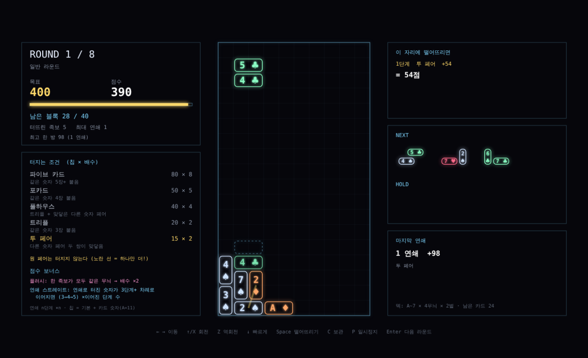

# 09. 테트리스 포커

최종 수정: 2026-11-07
상태: 프로토타입 3 (카드 2장씩 떨어지는 족보 퍼즐)

## 1. 배경
테트리스 디펜스는 화풍은 좋았지만 두 게임을 규칙으로 이어 붙여 억지스럽다는 평가를 받았다 ([08 문서 18절](08-shape-concepts.md)).
디펜스 장르는 흔해서 테트리스를 훅으로 유지하되, 테트리스와 자연스럽게 겹치는 장르로 포커(카드 게임)를 골랐다.

## 2. 왜 자연스러운가
- 테트리스는 "어디에 놓을까", 포커는 "무엇끼리 모을까"를 고민한다. 블록 하나를 놓는 행동이 두 고민을 동시에 푼다
- 연결 규칙이 하나다: 지운 줄의 카드로 족보
- 스트레이트만 위치를 따지게 해서, 블록 위치와 회전이 카드 배치가 된다
- 화면이 하나다

## 3. 핵심 규칙
프로토타입 README 참고: [prototype/tetris-poker](../prototype/tetris-poker/README.md)

## 4. 설계 결정
| 결정 | 이유 |
|---|---|
| 턴 방식 (자동 낙하 없음) → 실시간 낙하로 변경 | 1차는 생각할 시간을 주려고 턴 방식이었으나, 플레이 피드백으로 일반 테트리스처럼 계속 떨어지게 바꿈 |
| 점수 계산 중 멈춤 → 즉시 반영 | 피드백: 줄이 지워질 때 멈추지 말고 연속으로 터지게. 점수는 즉시, 연출은 잔상과 떠오르는 글자로만 |
| 콤보 배수 | 연속으로 터지는 흐름에 보상. 연달아 지우면 콤보 1마다 +25% |
| 미리보기 점수 | 놓기 전에 결과를 알아야 족보를 노리는 계획이 가능 |
| 발라트로식 칩 × 배수 | 검증된 점수 쾌감, 이후 조커로 확장하기 쉬움 |
| 보스 3라운드: 회전 금지 → 보관 금지 | 회전 금지는 테트리스 자체를 막아 봇 18/20판이 막힘 |

## 5. 다음 단계
1. 직접 플레이해 보고 핵심 재미 확인
2. 라운드 사이 상점과 조커 10종으로 로그라이트 루프 시험
3. 덱 꾸미기 (카드 강화, 삭제, 특수 카드)

## 6. v2: 족보로 터지는 낙하 퍼즐

피드백: 차별점이 없다. 테트리스에 점수만 더 주는 것 같다.

원인: 카드를 고를 수 없고 줄은 여전히 테트리스 규칙으로 지워져서, 포커가 플레이를 바꾸지 못하고 점수만 매겼다.

해결: 포커가 무엇이 터지는지를 정한다. 줄을 채우는 대신 카드끼리 족보를 이루면 그 카드가 터지고, 위 카드가 떨어져 연쇄가 일어난다 (뿌요뿌요, 컬럼스식 맞추기에 포커 족보를 기준으로).

| 결정 | 이유 |
|---|---|
| 같은 숫자는 상하좌우 덩어리, 스트레이트는 일직선 순서 | 숫자 맞추기와 배치 순서 맞추기라는 두 종류의 고민이 생김 |
| 꽉 찬 줄은 점수 없이 지움 | 테트리스 정체성은 남기되 점수원은 족보로 일원화 |
| 작은 덱 (A~7, 2벌) | 52장이면 같은 숫자가 이웃할 확률이 너무 낮아 거의 안 터짐. 덱 구성은 이후 로그라이트 요소 후보 |
| 연쇄 단계마다 0.28초 연출 | 연쇄를 눈으로 따라갈 수 있게. 이전의 1초 넘는 정지와 달리 짧게 |

자세한 규칙과 시험 결과: [prototype/tetris-poker](../prototype/tetris-poker/README.md)

## 7. v3: 카드 2장씩

피드백: 무조건 한 줄이 아니라 족보가 되어야 터지게 하고, 카드가 잘 안 보이니 2장씩 잡자. 연결된 카드 중에 족보에 맞으면 터지게.

| 결정 | 이유 |
|---|---|
| 블록을 카드 2장으로 | 카드를 크게 그릴 수 있고, 카드 한 장 한 장의 배치를 의도대로 고르기 쉬움 |
| 판 8 × 12, 칸 50픽셀 | 카드 숫자와 무늬가 한눈에 읽힘 |
| 받침 없는 카드는 각자 떨어짐 | 2장 블록 퍼즐의 표준 방식. 연쇄가 자연스럽게 생김 |
| 스트레이트는 이어진 카드를 따라 (꺾여도 됨) | "연결된 카드 중 족보" 기준. 2장 블록으로는 일직선 5칸이 너무 어려움 |
| 꽉 찬 줄 정리 삭제 | 카드가 각자 떨어지는 방식에서는 의미가 없음 |

## 8. v4: 규칙 단순화

피드백: 족보 붙이는 규칙이 헷갈린다. 원 페어, 투 페어는 없나?

| 결정 | 이유 |
|---|---|
| 터지는 조건은 두 가지뿐: 같은 숫자 3장 이상이 붙음(트리플, 포카드, 파이브 카드), 서로 다른 숫자 페어 두 쌍이 맞닿음(투 페어) | "같은 숫자를 모은다" 하나만 알면 됨. 투 페어로 원 페어 두 개를 엮는 수가 생김 |
| 트리플에 다른 숫자 페어가 맞닿으면 풀하우스로 함께 터짐 | 같은 숫자 모으기의 상위 보상 |
| 원 페어는 터지지 않고 노란 선으로 "하나만 더" 표시 | 원 페어가 터지면 판이 너무 쉽게 비고 계획할 여지가 없음 |
| 플러시와 스트레이트는 족보에서 빼고 보너스로 | 플러시: 한 족보가 모두 같은 무늬면 배수 ×2. 스트레이트: 연쇄로 터진 숫자가 3단계 이상 차례로 이어지면(3→4→5) ×이어진 단계 수 |

## 9. v5: 카드 한 장 = 칸 2개, 블록 = 4칸

피드백: 카드 크기를 네모 블록 2칸으로 잡아서 총 4칸짜리가 떨어지게.

| 결정 | 이유 |
|---|---|
| 카드는 칸 2개짜리 직사각형(세로로 서거나 가로로 누움) | 카드가 크게 보이면서 테트리스 블록 모양을 유지 |
| 블록 = 카드 2장 = 4칸, 모양은 I, O, L, J, S, Z | 4칸 테트리스 손맛. T는 2칸 카드 2장으로 나눌 수 없어 제외 |
| 블록 전체가 테트리스처럼 회전하고 카드도 같이 돈다 | 회전하면 세로 카드가 가로 카드가 되며 숫자 배치가 바뀜 |
| 내려앉으면 받침 없는 카드는 한 장씩 따로 떨어짐 | 연쇄가 자연스럽게 생김. 가로 카드는 한 칸만 받쳐도 걸림 |
| 붙음 판정은 카드 단위: 한 칸이라도 맞닿으면 붙은 것 | 큰 카드일수록 이웃이 많아 족보 만들기가 쉬워짐 |
| 판 10 × 18, 칸 34픽셀 | 일반 테트리스 비율 |
| 6·7·8라운드 목표를 2,150 / 2,650 / 3,200으로 낮춤 | 봇 40판 기준 6라운드(빨간 카드 보스)에서 많이 막히고 전부 통과 2판 |

이름 메모: "테트리스"는 상표라 출시 이름으로 쓸 수 없다. "Tetris Poker"는 내부 가제다.
