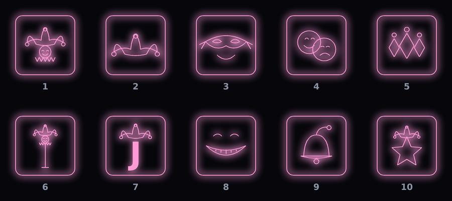

# 15. 화풍 규칙 (웹 프로토타입 네온)

**앞으로 그리는 모든 그림(타워, 적, 아이콘, 캐릭터, UI, 이펙트)은 이 규칙을 따른다.** (2026-11-10 확정)

기준 화면: 웹 프로토타입들 — `docs/images/prototype-tetris-defense.png`(포탑: 사각 틀 안의 기호), `docs/images/mock-neon-tower.png`(처음 정한 네온 목업), `docs/images/prototype-poker-defense.png`.
특징: 가늘고 또렷한 선, **넓고 부드럽게 퍼지는 빛번짐**(웹 캔버스 shadowBlur 느낌), 물체는 **둥근 사각 틀 안에 작은 기호**로 구분.

## 1. 한 줄 요약
어두운 배경 위에, **채우지 않은 한 가지 색 선**이 스스로 빛나는 단순한 도형. 그림은 모두 코드로 그린다 (이미지 파일 없음).

## 2. 바탕
| 항목 | 값 |
|---|---|
| 배경 | `#06060b` (거의 검정, 살짝 푸른 기) |
| 격자·구획선 | `#788cb4` 6~8% 불투명, 굵기 1 |
| 기준 화면 | 1280 × 720 (크기 값은 모두 이 기준) |

## 3. 선과 빛번짐
- **선만 그린다.** 면을 칠하지 않는다. 예외는 두 가지뿐: 영역 강조용 아주 옅은 채움(같은 색 7%), 글자 뒤 어두운 바탕(배경색 88%).
- 한 물체 = **한 가지 색**. 강조할 때만 가운데에 흰 심을 더한다 (레이저 등).
- 빛번짐은 넓고 옅게 퍼지게 (웹 캔버스 `shadowBlur` 8~18 과 같은 느낌). 언리얼 Slate 에는 블룸이 없으므로 같은 선을 네 겹으로 그린다:

| 겹 | 굵기 | 불투명도 |
|---|---|---|
| 가장 바깥 번짐 | 기본 굵기 × 10 | 4% |
| 바깥 번짐 | 기본 굵기 × 6 | 7% |
| 안쪽 번짐 | 기본 굵기 × 3.2 | 14% |
| 심 | 기본 굵기 × 0.8 | 100% |

- 기본 굵기: 보통 1.5~2.0, 강조 2.0~2.4, 보조 UI 선 1.0. **심은 가늘고 또렷하게**, 빛은 넓게.
- 모서리는 둥글게 (반지름 6~12). 곡선은 베지어·매개변수 곡선을 잘게 나눈 꺾은선으로.

## 4. 색
| 쓰임 | 색 |
|---|---|
| ♠ 스페이드 | `#7fb8ff` 파랑 |
| ♥ 하트 | `#ff6a8a` 빨강 |
| ♦ 다이아 | `#ffd96a` 노랑 |
| ♣ 클로버 | `#8affc4` 초록 |
| 조커·와일드·특수 | `#ff9ad5` 분홍 / `#ffffff` 흰색 |
| UI 기본 강조 | `#7fd6ff` 하늘 |
| 점수·보상·금 | `#ffd96a` |
| 좋음·통과 | `#9cffb0` |
| 위험·실패 | `#ff6a6a` |
| 본문 글자 / 보조 / 흐림 | `#cfd8e6` / `#8a94a6` / `#5f6878` |
| 적 | 보통 `#e8f0ff`, 빠름 `#ffa86a`, 탱크 `#c49aff`, 방패 `#9fc3e8`, 분열 `#ff9ad5`, 재생 `#b6ff6a` |

새 색이 필요하면 위 색과 밝기를 맞춘 파스텔 네온으로 고르고 이 표에 더한다.

## 5. 모양 (캐릭터·아이콘 그리는 법)
- **선 몇 개로 알아볼 수 있는 실루엣**이 먼저다. 세부 묘사, 명암, 질감은 넣지 않는다.
- 판 위 크기(반지름 약 22px)로 줄여도 알아볼 수 있어야 한다. 작게 그려서 확인한다.
- 좌우 대칭을 기본으로. 선 굵기는 한 그림 안에서 같게.
- 얼굴은 동그라미 하나 + 눈 두 개(짧은 호) + 입 하나(호). 코·귀·머리카락은 그리지 않는다.
- 겹치는 도형은 바깥 테두리 하나로 합친다 (예: 클로버 잎 셋). 안쪽 선이 글자를 가로지르지 않게.
- 숫자·글자는 도형 안쪽 비어 있는 자리에, 같은 색 굵은 글꼴로.
- **판 위 물체(타워·포탑·건물)는 둥근 사각 틀(칸의 약 80%, 모서리 반지름 = 틀 반 너비의 22%) 안에 기호를 넣는다.** 강조(족보·강화) 상태는 틀 안을 같은 색 8~13%로 옅게 채우고 숨쉬게 한다.
- 예시:
  - 타워: 틀 + 위쪽에 숫자 + 아래쪽에 작은 무늬 기호. 와일드는 틀 + 별
  - 카드 무늬 기호: 스페이드 = 뒤집은 하트 + 꼬리, 하트 = 하트 곡선, 다이아 = 마름모, 클로버 = 잎 셋 테두리 + 꼬리
  - 조커: 방울 달린 세 갈래 모자(양옆 뿔은 아래로 처짐) + 웃는 얼굴 + 뾰족한 옷깃
  - 적: 원, 삼각형, 육각형 등 기본 도형에 특징 하나(방패 막대, 십자, 겹친 원)

## 6. 움직임과 이펙트
| 이펙트 | 규칙 |
|---|---|
| 파티클 | 작은 정사각형(2~3px) + 그 4배 크기 옅은 번짐(15%). 줄무늬 파티클은 속도 방향으로 짧은 선 |
| 고리(충격파) | 반지름이 빠르게 커졌다 느려짐(ease-out), 투명해지며 사라짐 |
| 레이저 | 색 선 + 가운데 흰 심, 0.12초 |
| 숨쉬기 | sin 으로 밝기·크기 ±6~20% |
| 등장 | 1.5배에서 1배로 0.3초 |
| 화면 번쩍임 | 최대 45% 불투명, 0.3~0.6초 |
| 화면 흔들림 | 최대 14px, 0.6초 이하 |

## 7. 하지 않는 것
- 면 채우기, 그라데이션, 질감, 사진, 픽셀 아트, 수채화, 손그림 느낌
- 한 물체에 여러 색 (흰 심 제외)
- 외부 이미지·에셋 파일 (모든 그림은 코드)
- 가는 선을 배경 없이 글자 위에 겹치기

## 8. 도구
- 언리얼: `Source/ProjectB/PDBoardWidget.cpp` 의 `FCanvas` (Glow, Lines, Shape, CardShape, Badge ...)가 이 규칙대로 그린다. 새 그림은 여기에 함수로 더한다.
- 미리보기: `tools/neon/neon.py` — 언리얼 빌드 없이 같은 화풍으로 PNG를 그려 확인한다 (`towers`, `suits`, `joker`). 새 그림은 여기서 먼저 그려 보고 언리얼로 옮긴다.

## 9. 저장된 그림: 조커 10종 (2026-11-10)

사용자가 10종 모두 마음에 들어 함. 쓰임은 아직 미정 (후보: 조커 카드마다 무작위 얼굴, 보상 조커 아이콘).
그림 코드: `tools/neon/neon.py` 의 `joker_cards()` (j1~j10). 미리보기: `python3 tools/neon/neon.py jokers 출력.png`

| 번호 | 함수 | 그림 |
|---|---|---|
| 1 | j1 | 광대 머리: 방울 세 갈래 모자 + 웃는 얼굴 + 뾰족한 옷깃 |
| 2 | j2 | 광대 모자만 (방울 셋) |
| 3 | j3 | 웃는 가면: 눈가리개 + 미소 + 양옆 끈 |
| 4 | j4 | 희비극 가면: 웃는 얼굴과 우는 얼굴이 겹침 |
| 5 | j5 | 할리퀸 마름모 셋 + 방울 |
| 6 | j6 | 광대 지팡이: 막대 끝에 작은 광대 머리 |
| 7 | j7 | 광대 모자를 쓴 J 글자 |
| 8 | j8 | 체셔 미소: 이빨 보이는 큰 웃음 + 웃는 눈 |
| 9 | j9 | 방울 하나 + 위로 말린 모자 끝 |
| 10 | j10 | 광대 모자를 쓴 별 |

공통: 둥근 사각 틀(반 너비 0.98R, 모서리 0.22R) 안, 분홍 `#ff9ad5`, 좌표는 틀 중심 기준 R 단위. 언리얼로 옮길 때는 같은 좌표로 `FCanvas` 함수를 만든다.
