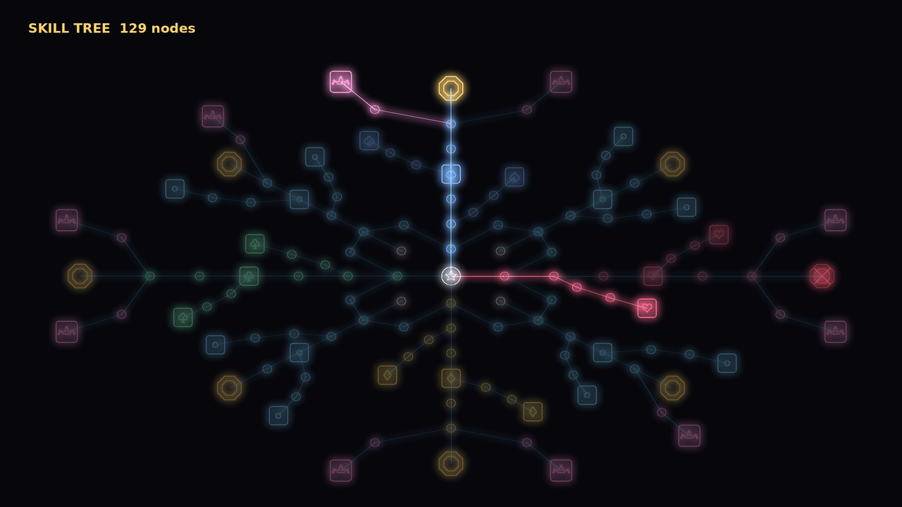

# 16. 스킬 트리와 골드 강화 (포커 디펜스 v1.7)

적을 잡아 번 골드는 두 군데에 쓴다.
- **스킬 트리**: 포인트를 사서 노드를 찍는다. 짝 키스톤과 가파른 값 때문에 다 찍을 수 없다
- **골드 강화**: 공격·공격 속도·치명타·무늬 강화 8종을 레벨 9999까지 올린다. 무한 진행 후반에 남는 골드를 받아 주는 곳

둘 다 **판 안에서만 유지**되고 새 판은 처음부터 시작한다.
트리 구조는 패스 오브 엑자일 트리 (ProjectA `docs/PoE1_PassiveTree_Reverse.md`)를 줄여서 따랐다.

(미리보기: `python3 tools/tree/gen_tree.py && python3 tools/neon/neon.py tree 출력.png tools/tree/tree.json`. 밝은 선이 찍은 길, 빨간 X 는 봉인된 키스톤)

## 1. 골드

| 얻는 곳 | 골드 |
|---|---|
| 보통·빠름·분열 조각 처치 | 1 |
| 방패병·분열체·재생자 처치 | 2 |
| 탱크 처치 | 3 |
| 보스 처치 | 25 |
| 5웨이브마다 (보스·조각 제외) | 처치당 +1 |
| 웨이브 통과 | 5 + 웨이브 번호 |

골드 노드(살림)는 위 전부에 +15%.

## 2. 트리 구조 (129노드): 큰길 + 막다른 주머니

PoE 트리가 덜 엉켜 보이는 까닭은 노드가 많아서이기도 하지만, 묶음 대부분이 큰길 옆에 **입구 하나로 매달린 막다른 주머니**이기 때문이다. v1.6(61노드)은 다리가 양쪽 팔에 다 붙고 안쪽 고리가 팔 넷을 이어서 고리가 8개였다 (노드 8개마다 하나). v1.7 은 고리를 4개로 줄이고 주머니 구조로 바꿨다.

| 부분 | 개수 | 생김새 |
|---|---|---|
| 시작 | 1 | 가운데 |
| 무늬 큰길 (♠ 위, ♥ 오른쪽, ♦ 아래, ♣ 왼쪽) | 4 × 17 | 큰길 6 (넷째가 특급) → 끝에 키스톤. 옆 주머니 2개 (작은 2 + 특급). 큰길 끝 양옆에 조커 갈림길 → 조커 강화 |
| 족보 큰길 (이웃 무늬 사이) | 4 × 15 | 이웃한 두 무늬 큰길의 첫 노드를 잇는 연결 길 3 (고리는 이 4개뿐), 가운데에서 족보 큰길 4 → 키스톤. 옆 주머니 2개. 연결 길 안쪽에 살림 노드 하나 |
| 플러시·합성 족보 큰길의 조커 | 2 × 2 | 갈림길 → 할리퀸 / 웃는 가면 |

- 키스톤 8개와 조커 강화 10개는 **모두 막다른 끝**이다. 끝자락끼리는 이어지지 않아, 다른 조커를 강화하려면 안쪽으로 돌아가 다른 가지를 다시 타야 한다 (조커 강화 사이 최소 4걸음)
- 특급 노드 24개 (큰길 위 8, 주머니 16), 시작에서 가장 먼 노드 8포인트
- 판당 찍는 포인트는 봇 기준 아래 7절. 129개 중 1~2할

### 무늬 큰길

| 무늬 | 큰길 (작은) | 큰길 특급 | 주머니 A (특급 옆) | 주머니 B (둘째 노드 옆) | 키스톤 | 조커 |
|---|---|---|---|---|---|---|
| ♠ 저격 | ♠ 위력 +10%, 사거리 +8%, 치명타 배율 +0.15 | 명사수: ♠ 위력 +20%, 사거리 +10% | 저격수의 눈: 치명타 확률 +3%p ×2 → 치명타 확률 +5%p, 배율 +0.3 | 망원 조준: ♠ 사거리 | 고독한 저격수 | 체셔, 잭 |
| ♥ 폭발 | ♥ 위력 +10%, 폭발 범위 +0.15칸 | 불꽃놀이: ♥ 위력 +20%, 범위 +0.2칸 | 화약고: ♥ 위력 | 연쇄 폭발: ♥ 폭발 범위 | 군중 | 스타, 희비극 |
| ♦ 연사 | ♦ 연사 +8%, ♦ 위력 +10%, 공격 속도 +4% | 기관총: ♦ 연사 +20%, 위력 +10% | 탄창: ♦ 위력 | 과열: 공격 속도 +5% ×2 → 공격 속도 +10%, ♦ 연사 +15% | 잡식가 | 광대, 지휘봉 |
| ♣ 둔화 | ♣ 위력 +10%, 둔화 +5%p, 치명타 확률 +2%p | 얼음 손: ♣ 둔화 +10%p, 사거리 +15% | 서릿발: ♣ 위력 | 빙하: ♣ 둔화 | 광대의 길 | 방울, 모자 장수 |

큰길에는 길 메우기 노드(모든 타워 위력 +4%)도 섞여 있다 (PoE 의 능력치 +10 노드).

### 족보 큰길

| 사이 | 주제 | 큰길 특급 | 주머니 1 | 주머니 2 | 키스톤 | 살림 |
|---|---|---|---|---|---|---|
| ♠♥ | 같은 숫자 | 거울: 같은 숫자 족보 +25% | 쌍둥이: 원 페어·투 페어 | 다섯 손가락: 트리플·포카드·**파이브 카드** | 작은 판 | 골드 +15% |
| ♥♦ | 플러시 | 물든 패: 플러시 계열 위력·범위 | **왕관: 스트레이트 플러시·로열 위력 +40%, 연사 +20%** | 번지는 물감: 플러시 범위 | 외골수 | 손패 최대 +1 |
| ♦♣ | 스트레이트 | 흐름: 스트레이트 계열 연사·위력 | 긴 줄: 스트레이트 위력 | 장전: 스트레이트 연사 | 큰 판 | 목숨 +4 |
| ♣♠ | 합성·연쇄 | 단조: 합성 배율 +0.15, 연쇄 덤 | 대장간: 합성 타워 위력, 합성 배율 +0.2 | 조커 공방: 조커 포탑 위력, 조커 배율 +0.1 | 대장장이 | 웨이브마다 카드 +1 |

연결 길에는 모든 타워 위력 +4% 와 공격 속도 +3% / 치명타 확률 +2%p / 치명타 배율 +0.1 이 섞여 있다.
같은 종류는 더해서 한 번에 곱한다 (PoE 의 increased). 키스톤·조커 강화·골드 강화는 따로 곱한다 (more).

## 3. 포인트 값

- 첫 포인트 20골드, 찍을 때마다 **×1.22** (20, 24, 30, 36, 44 … 10번째 120, 20번째 875, 30번째 6,389, 40번째 46,673)
- 노드 하나 = 포인트 하나. 이미 찍은 노드와 이어진 노드만 살 수 있다 (멀수록 비싸다)
- 트리 창(K 또는 [트리] 버튼)과 강화 창(U 또는 [강화] 버튼)을 여는 동안은 게임이 멈춘다. 보상 고르는 중에는 찍을 수 없다

## 4. 반대되는 노드: 짝 키스톤

키스톤은 둘씩 짝이다. **하나를 찍으면 짝은 그 판 동안 봉인**되고 다시 열 수 없다. 키스톤은 **판마다 최대 3개**.
골드가 아무리 많아도 반대되는 규칙을 함께 가질 수 없고, 판마다 빌드 성격이 키스톤 3개로 갈린다.

| 짝 A | 짝 B |
|---|---|
| **외골수** (플러시 큰길): 플러시 타워 위력 ×2, 다른 족보 타워 위력 ×0.5 | **잡식가** (♦ 큰길): 플러시 아닌 족보 위력 ×1.3, 플러시 범위 효과 없음 |
| **큰 판** (스트레이트 큰길): 5장 족보 위력 ×1.6, 2장 족보는 효과·연쇄 없음 | **작은 판** (같은 숫자 큰길): 원 페어·투 페어 위력 ×1.8, 5장 족보는 연쇄 덤 없음 |
| **대장장이** (합성 큰길): 합성 배율 1.5 → 2.0, 조커 포탑을 만들 수 없음 | **광대의 길** (♣ 큰길): 조커 배율 1.2 → 1.6, 합성은 레벨 2까지 |
| **고독한 저격수** (♠ 큰길): 족보에 안 든 타워 위력 ×1.6, 연쇄 덤 없음 | **군중** (♥ 큰길): 연쇄 덤 +25% → +40%, 족보에 안 든 타워 위력 ×0.5 |

## 5. 조커 강화 (바깥 끝자락)

| 조커 (대장 족보) | 뿌리 | 강화 |
|---|---|---|
| 체셔 (포카드) · 잭 (트리플) | ♠ 큰길 끝 | 체셔 위력 ×1.5 / 잭 공격력 ×3 → ×5 |
| 스타 (로열) · 희비극 (원 페어) | ♥ 큰길 끝 | 스타 레이저 위력 ×0.5 → ×0.8 / 희비극 셋째 적까지 함께 공격 |
| 광대 (파이브 카드) · 지휘봉 (스트레이트) | ♦ 큰길 끝 | 광대 연사 +50% / 지휘봉 주변 연사 +40% → +70% |
| 방울 (풀하우스) · 모자 장수 (스트레이트 플러시) | ♣ 큰길 끝 | 방울 5초마다 2초 멈춤 / 모자 장수 오라 +50%, 주변 24칸 |
| 할리퀸 (플러시) | 플러시 큰길 | 같은 무늬 공격력 +30% → +60% |
| 웃는 가면 (투 페어) | 합성 큰길 | 따라 한 공격 위력 ×1.3 |

갈림길(조커 포탑 위력 +10%)을 하나 거쳐야 닿는다.

## 6. 골드 강화 (레벨 0~9999)

| 강화 | 레벨당 | 9999레벨 |
|---|---|---|
| 공격 | 모든 타워 공격력 +1% | ×101 |
| 공격 속도 | 모든 타워 공격 속도 +1% | ×101 (한 틱 0.05초보다 빠르면 남는 만큼 피해로) |
| 치명타 확률 | +0.1%p (기본 5%) | 1,005% = 한 방에 치명타 10~11번 |
| 치명타 배율 | +0.01 (기본 ×1.5) | ×101.5 |
| ♠ ♥ ♦ ♣ 강화 | 그 무늬 타워 공격력 +2% | ×201 |

- 값: 레벨 L → L+1 에 **10 + 2L 골드** (10, 12, 14 …). 한 종류를 9999까지 올리려면 약 1억 골드. 트리 포인트(×1.22)와 달리 천천히 오르므로 후반 골드는 강화로 흘러간다
- 강화 창에서 +1 / +10 / +100 / 최대(지금 골드로 살 수 있는 만큼)
- **치명타**: 공격마다 굴린다. 치명타 확률이 100%를 넘으면 넘친 만큼 치명타가 한 방에 여러 번 (150% = 1번 확정 + 50% 로 2번). 피해 = 공격력 × (1 + 치명타 횟수 × (배율 − 1)). 기대 배율 = 1 + 확률 × (배율 − 1)
- 트리에도 공격 속도·치명타 노드가 있다 (♠·♣·♦ 큰길, 연결 길, 저격수의 눈·과열 주머니). 트리와 강화는 따로 곱한다

## 7. 봇 결과

`./Tests/run.sh 10 tree` (봇은 골드가 되는 만큼, 판 위력이 골드당 가장 많이 오르는 노드나 강화를 산다):

| 봇 (10판) | 평균 웨이브 | 판에서 번 골드 | 찍은 포인트 | 강화에 쓴 골드 |
|---|---|---|---|---|
| 합성 · 조커 (대장) | 19.6 | 2,127 | 0 | 0 |
| + 트리 (129노드) | 25.6 | 4,755 | 18.4 | 0 |
| + 트리 + 골드 강화 (무늬 강화 레벨당 +2%) | 26.7 | 4,951 | 13.8 | 3,259 |

- 트리는 6웨이브, 강화까지 쓰면 7웨이브를 더 버티게 해 준다. 61노드 때(+4.4)보다 조금 세다. 길 메우기 노드와 치명타 노드가 늘어난 몫이고, 더 낮추려면 포인트 값 배율(×1.22)을 올리면 된다
- 판당 18포인트 = 트리의 14%. 다 찍는 일은 없다
- 강화는 공격·공격 속도에 각 28레벨, ♠ 강화에 22레벨이 몰렸다. 치명타는 배율이 낮을 때 효율이 떨어져 봇이 거의 안 샀다. 사람이 확률·배율을 같이 올리면 커진다
- 무늬 강화는 처음 레벨당 +3% 였다가 한 무늬 몰빵 체감을 줄이려고 +2% 로 낮췄다 (봇 평균 26.6 → 26.7, 차이 없음. 몰빵하는 후반에 차이가 난다)
- 61노드 때의 조정 기록: 처음 값(15골드 ×1.15, 고독한 저격수 ×2.5)은 27.9웨이브로 너무 세서 20골드 ×1.22, ×1.6 으로 낮췄다 (트리 없이 18.7 → 23.1)

## 8. 화면

- 오른쪽 패널 위: 골드, 다음 포인트 값, [강화 (U)]·[트리 (K)] 버튼
- 트리 창: 화풍(docs/15)대로 네온 선. 작은 = 동그라미, 특급 = 둥근 사각 틀 + 무늬, 키스톤 = 금색 팔각 이중 틀, 조커 강화 = 그 조커의 분홍 틀 그림. 찍은 노드는 밝게, 찍을 수 있는 노드는 숨쉬고, 봉인된 키스톤은 빨간 X. 마우스를 올리면 이름·효과·상태
- 강화 창: 8줄 (이름, 레벨, 지금 효과, 버튼 4개와 값)
- 치명타는 흰 불꽃과 고리 (여러 번이면 더 크게). 타워 설명에 치명 확률·배율

## 9. 코드

- `tools/tree/gen_tree.py`: 트리 배치와 효과의 원본. 실행하면 `Source/ProjectB/PDTreeData.inl`(코어), `PDTreeText.inl`(화면 이름, UTF-8 BOM), `tools/tree/tree.json`(미리보기)을 만든다
- `PDCore.h/.cpp`: `TreeNode()`·`TreeLinks()`, `BuildTreeMods()`, `FPDGame::BuyNode()`·`CanBuy()`·`TreeSealed()`, 골드 강화 `Upgrade()`·`UpgradeCost()`·`ApplyUpgrades()`, 치명타는 `FPDTowerStats::Crit`·`CritMult` 와 `Update()` 의 굴림
- `PDBoardWidget.cpp`: 트리 창 (K), 강화 창 (U), 글자 표
