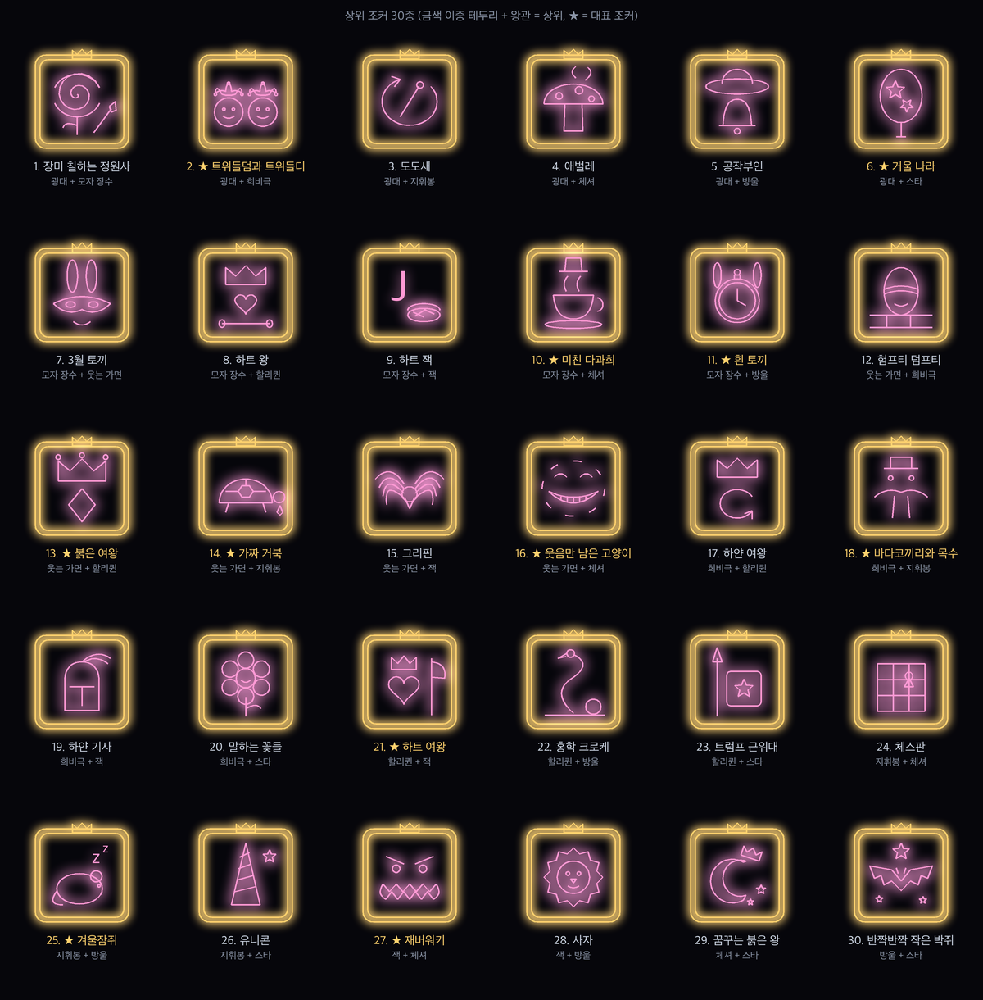

# 18. 상위 조커 30종 (조커 합성, 기획 초안)

최종 수정: 2026-11-15
상태: 초안. 이름·능력·숫자는 봇 밸런스와 미리보기 그림을 보고 고친다.
관련: docs/17 5절, docs/16(스킬 트리), 로드맵 구현 6번, D-073(트리 끝자락), D-075(대장 조커), D-098(조커 레벨), D-114(같은 조커 합치기)

## 1. 규칙

| 항목 | 내용 |
|---|---|
| 재료 | **서로 다른** 기본 조커 둘. 판 위에서 상하좌우로 맞닿아 있어야 한다 |
| 조건 | 둘 다 조커 레벨 10 이상 (레벨 10 = 기본 조커 강화 능력이 열리는 레벨, D-098) |
| 레시피 | 조합 45가지 중 30개. 레시피 없는 조합은 합성 버튼이 안 뜬다 |
| 결과 | 고른 재료 칸에 상위 조커 1개, 다른 칸은 빈다. 최종형이라 더 합치지 않는다 |
| 위력 | (재료 둘 위력 합) × 1.5 (봇으로 조정) |
| 조커 레벨 | 재료 중 높은 쪽 조커 레벨을 이어받고, 계속 먹여서 올린다 |
| 지휘 | 재료 둘의 대장 지휘(자기 족보 타워 +30%)를 둘 다 가진다 |
| 같은 조커 합치기 | 기본 조커끼리 같은 종류 합치기(D-114)는 그대로. 상위 조커끼리 같은 종류도 같은 규칙 |
| 발견 | 조커 도감에 30칸. 처음엔 실루엣과 재료 하나만 보이는 힌트, 처음 만들면 이름·그림·능력·레시피 공개 (영구 저장) |
| 그림 | 분홍 기호(인물 상징, 재료 조커 부분을 섞기도) + 상위 표시(금색 이중 테두리·틀 위 작은 왕관). 미리보기 `docs/images/upper_jokers_preview.png` (`python tools/neon/upper_jokers.py 출력.png`) |
| 주제 | 이상한 나라의 앨리스·거울 나라의 앨리스 인물 (원작 저작권 만료). ★ = 고유 능력 대표 조커 |

## 2. 기본 조커 능력 (지금)

| 조커 | 대장 족보 | 능력 |
|---|---|---|
| 광대 | 파이브 카드 | 무늬 4종 공격을 번갈아 (♠ 저격 · ♥ 폭발 · ♦ 연사 · ♣ 둔화) |
| 모자 장수 | 스트레이트 플러시 | 주변 8칸 타워 공격력 +25% · 사거리 +10% |
| 웃는 가면 | 투 페어 | 주변 가장 강한 타워의 공격을 따라 함 |
| 희비극 | 원 페어 | 두 적을 동시에 공격 |
| 할리퀸 | 플러시 | 판 위 같은 무늬 타워 공격력 +30% |
| 지휘봉 | 스트레이트 | 주변 8칸 타워 연사 +40% |
| 잭 | 트리플 | 공격력 ×3, 연사 ×0.5 |
| 체셔 | 포카드 | 사거리 무한 |
| 방울 | 풀하우스 | 8초마다 사거리 안 적 1.5초 멈춤 |
| 스타 | 로열 스트레이트 플러시 | 1초마다 판 전체 모든 적에게 피해 |

## 3. 조합표 (○ = 레시피, · = 없음)

조커마다 레시피 6개, 없는 조합 3개.

| | 광대 | 모자 | 가면 | 희비 | 할리 | 지휘 | 잭 | 체셔 | 방울 | 스타 |
|---|---|---|---|---|---|---|---|---|---|---|
| 광대 | — | ○ | · | ○ | · | ○ | · | ○ | ○ | ○ |
| 모자 장수 | ○ | — | ○ | · | ○ | · | ○ | ○ | ○ | · |
| 웃는 가면 | · | ○ | — | ○ | ○ | ○ | ○ | ○ | · | · |
| 희비극 | ○ | · | ○ | — | ○ | ○ | ○ | · | · | ○ |
| 할리퀸 | · | ○ | ○ | ○ | — | · | ○ | · | ○ | ○ |
| 지휘봉 | ○ | · | ○ | ○ | · | — | · | ○ | ○ | ○ |
| 잭 | · | ○ | ○ | ○ | ○ | · | — | ○ | ○ | · |
| 체셔 | ○ | ○ | ○ | · | · | ○ | ○ | — | · | ○ |
| 방울 | ○ | ○ | · | · | ○ | ○ | ○ | · | — | ○ |
| 스타 | ○ | · | · | ○ | ○ | ○ | · | ○ | ○ | — |

없는 조합 15개와 이유:
- 주변 강화끼리 겹침: 모자 장수 + 지휘봉
- 따라 하기와 번갈아 쓰기가 엉킴: 광대 + 웃는 가면
- 무늬 강화와 무늬 순환이 따로 놂: 광대 + 할리퀸
- 한 방(잭)과 맞지 않음: 광대 + 잭, 지휘봉 + 잭, 잭 + 스타
- 판 전체 공격에 의미가 없어짐: 모자 장수 + 스타, 웃는 가면 + 스타
- 나머지는 능력이 거의 더하기만 되는 조합: 모자 장수 + 희비극, 웃는 가면 + 방울, 희비극 + 체셔, 희비극 + 방울, 할리퀸 + 지휘봉, 할리퀸 + 체셔, 체셔 + 방울

## 4. 상위 조커 30종

| # | 재료 | 이름 | 능력 (초안) |
|---|---|---|---|
| 1 | 광대 + 모자 장수 | 장미 칠하는 정원사 | 주변 8칸 타워 공격에 무늬 효과 덤이 4종 번갈아 붙는다 (저격 → 폭발 → 연사 → 둔화) |
| 2 | 광대 + 희비극 | ★ 트위들덤과 트위들디 | 두 적을 동시에, 둘이 서로 다른 무늬로 공격 (무늬 효과 둘씩) |
| 3 | 광대 + 지휘봉 | 도도새 | 주변 8칸 연사 +40%, 지금 무늬 차례의 효과를 주변 타워에도 덤으로 |
| 4 | 광대 + 체셔 | 애벌레 | 사거리 무한 + 무늬 4종 번갈아. 둔화 차례엔 판 전체 적 둔화 |
| 5 | 광대 + 방울 | 공작부인 | 무늬 4종 번갈아. 둔화 차례마다 사거리 안 적 1초 멈춤 (방울보다 자주) |
| 6 | 광대 + 스타 | ★ 거울 나라 | 1초마다 판 전체 피해, 피해 무늬가 4종 번갈아 (폭발 차례엔 위력 2배, 둔화 차례엔 판 전체 둔화) |
| 7 | 모자 장수 + 웃는 가면 | 3월 토끼 | 주변 가장 강한 타워를 따라 하고, 주변 8칸 공격력 +25% · 사거리 +10% |
| 8 | 모자 장수 + 할리퀸 | 하트 왕 | 주변 8칸 공격력 +25%, 판 위 같은 무늬 타워 +30% (둘 다, 겹치면 곱) |
| 9 | 모자 장수 + 잭 | 하트 잭 | 공격력 ×3 · 연사 ×0.5, 주변 8칸 타워 공격력 +40% |
| 10 | 모자 장수 + 체셔 | ★ 미친 다과회 | 주변 8칸 타워 사거리 무한 + 공격력 +25% |
| 11 | 모자 장수 + 방울 | ★ 흰 토끼 | 회중시계: 10초마다 판 전체 적 1초 멈춤, 주변 8칸 공격력 +25% |
| 12 | 웃는 가면 + 희비극 | 험프티 덤프티 | 주변 가장 강한 타워의 공격을 두 적에게 |
| 13 | 웃는 가면 + 할리퀸 | ★ 붉은 여왕 | 판 위 같은 무늬 타워 중 가장 강한 타워를 따라 하고, 같은 무늬 타워 +30% |
| 14 | 웃는 가면 + 지휘봉 | ★ 가짜 거북 | 주변 가장 빠른 타워를 따라 하고, 주변 8칸 연사 +40% |
| 15 | 웃는 가면 + 잭 | 그리핀 | 주변 가장 강한 타워의 공격을 위력 ×3 · 연사 ×0.5 로 |
| 16 | 웃는 가면 + 체셔 | ★ 웃음만 남은 고양이 | 판 전체에서 가장 강한 타워를 따라 함 (사거리 무한) |
| 17 | 희비극 + 할리퀸 | 하얀 여왕 | 두 적 공격, 판 위 같은 무늬 타워 +30% |
| 18 | 희비극 + 지휘봉 | ★ 바다코끼리와 목수 | 세 적 동시 공격, 주변 8칸 연사 +40% |
| 19 | 희비극 + 잭 | 하얀 기사 | 두 적에게 위력 ×3 · 연사 ×0.5 |
| 20 | 희비극 + 스타 | 말하는 꽃들 | 1초마다 판 전체 피해, 체력이 가장 많은 적 둘에게는 2배 |
| 21 | 할리퀸 + 잭 | ★ 하트 여왕 | 위력 ×3 · 연사 ×0.5, "목을 쳐라": 사거리 안 체력 15% 이하 적 즉시 처치 (보스 제외), 같은 무늬 타워 +30% |
| 22 | 할리퀸 + 방울 | 홍학 크로케 | 같은 무늬 타워 +30%, 5초마다 사거리 안 적 1.5초 멈춤, 멈춘 적이 받는 피해 +30% |
| 23 | 할리퀸 + 스타 | 트럼프 근위대 | 1초마다 판 전체 피해, 판 위 같은 무늬 타워 수만큼 피해 +5% |
| 24 | 지휘봉 + 체셔 | 체스판 | 사거리 무한, 주변 8칸 연사 +40% |
| 25 | 지휘봉 + 방울 | ★ 겨울잠쥐 | 8초마다 사거리 안 적 1.5초 멈춤, 멈춘 동안 주변 8칸 연사 ×2 |
| 26 | 지휘봉 + 스타 | 유니콘 | 0.6초마다 판 전체 피해, 주변 8칸 연사 +40% |
| 27 | 잭 + 체셔 | ★ 재버워키 | 사거리 무한, 위력 ×3 · 연사 ×0.5, 보스를 먼저 노리고 보스에게 +50% |
| 28 | 잭 + 방울 | 사자 | 위력 ×3 · 연사 ×0.5, 맞은 적 1초 멈춤 |
| 29 | 체셔 + 스타 | 꿈꾸는 붉은 왕 | 1초마다 판 전체 피해, 길 입구에 가장 가까운 적(가장 먼 적)에게 저격 한 방 더 |
| 30 | 방울 + 스타 | 반짝반짝 작은 박쥐 | 1초마다 판 전체 피해, 다섯 번째마다 판 전체 적 1초 멈춤 |

★ 대표 조커 11종: 트위들덤과 트위들디, 거울 나라, 미친 다과회, 흰 토끼, 붉은 여왕, 가짜 거북, 웃음만 남은 고양이, 바다코끼리와 목수, 하트 여왕, 겨울잠쥐, 재버워키.

## 5. 스킬 트리 연계 (초안)

트리를 새로 짜지 않고, 지금 129노드에 '상위 조커로 가는 길'을 얹는다.

### 5-1. 조커 강화 끝자락 = 상위 조커 재료 준비 (기존 10노드 효과 추가)
지금 조커 강화 10개는 바깥 막다른 끝이다 (D-073, 조커 강화 사이 최소 4걸음). 여기에 효과를 하나 더한다.
- 그 조커는 **조커 레벨 5부터** 상위 조커 재료가 된다 (보통은 10).
- 그 조커로 만든 상위 조커는 **위력 +25%** (재료 둘 다 찍었으면 +50%).

재료 두 조커의 끝자락이 트리의 어디에 있느냐에 따라 길이 달라진다.
- **쉬운 조합 (같은 큰길 끝, 한 길로 둘 다 닿음)**: 재버워키(잭 + 체셔, ♠), 말하는 꽃들(희비극 + 스타, ♥), 도도새(광대 + 지휘봉, ♦), 흰 토끼(모자 장수 + 방울, ♣)
- **어려운 조합 (반대쪽 큰길)**: 둘 다 찍으려면 트리를 가로질러야 해서 포인트가 많이 든다. 대신 다른 노드를 덜 찍는다.
- 판 초반에 "이번 판은 미친 다과회로 간다"고 정하면 트리 길이 정해진다. 상위 조커가 트리 빌드의 목표가 된다.

### 5-2. 새 짝 키스톤 하나 (키스톤 8 → 10, 판마다 최대 3개는 그대로)
| 짝 A | 짝 B |
|---|---|
| **왕관의 무게**: 상위 조커 위력 배율 ×1.5 → ×2.2, 기본 조커의 대장 지휘 효과 없음 | **서커스**: 상위 조커를 만들 수 없음. 판 위 기본 조커 하나마다 모든 조커 위력 +15% |

- 위치: 조커 갈림길이 모이는 바깥쪽 (자리는 `tools/tree/gen_tree.py` 에서 정함). 기존 '대장장이 / 광대의 길' 짝과 겹치지 않게.
- 상위 조커 빌드(소수 정예)와 기본 조커 다수 빌드가 갈린다.

### 5-3. 특급 노드 하나: 다과회 초대장
- 상위 조커 합성 조건 조커 레벨 10 → 7, 상위 조커 위력 +15%.
- 조커 갈림길 근처. 5-1과 겹치면 낮은 쪽(5)을 쓴다.

### 5-4. 레벨 경제와 영구 강화
- 트리 포인트는 레벨업으로 얻는다 (docs/17 3절). 상위 조커를 노리는 판은 끝자락 두 개 + 길에 포인트가 몰리므로, 레벨 곡선은 봇으로 '30 모드에서 상위 조커 1~2개'가 되게 맞춘다.
- 5-2 키스톤 짝과 5-3 노드는 영구 강화 해금으로 연다 (처음 상위 조커를 만들면 해금 목록에 뜸).

## 6. 정할 것

- [ ] 조건 레벨 (안: 둘 다 조커 레벨 10, 트리 끝자락을 찍은 조커는 5, 다과회 초대장 7)
- [ ] 트리 연계(5절) 확정: 끝자락 효과 추가, 새 짝 키스톤, 특급 노드 하나
- [ ] 위력 배율 (안: 재료 합 × 1.5)
- [ ] 처음부터 30종 다 만들 수 있게 할지, 일부를 영구 강화 해금으로 잠글지 (안: 레시피는 처음부터 다 되고, 영구 강화로 '힌트'를 연다)
- [ ] 멈춤·즉시 처치 계열(흰 토끼, 하트 여왕, 반짝반짝 작은 박쥐)이 보스전을 깨지 않는지 봇으로 확인
- [ ] 이름 30개 확정, 언어팩 번역 (tools/lang)
- [x] 미리보기 그림 30장 (`tools/neon/upper_jokers.py`, 2026-11-15) — 확정 전
