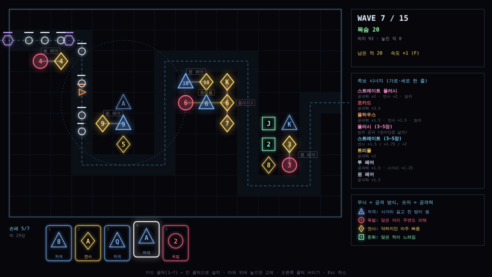

# 포커 디펜스 프로토타입 (가칭) v1

카드로 타워를 세우는 디펜스. 핵심 루프만 만든 첫 프로토타입이다. 기획 메모는 [docs/14-poker-defense.md](../../docs/14-poker-defense.md).

- 카드 한 장 = 타워 하나. **무늬 = 공격 방식, 숫자 = 공격력** (2~10, J Q K A = 11~14)
- **가로나 세로로 한 줄로 붙은 타워들**이 포커 족보가 되면 시너지. 가로·세로 둘 다 걸리면 효과를 둘 다 받는다
- 웨이브를 막을 때마다 카드 3장 (처음 5장, 손패 최대 7장, 덱 52장)
- 카드를 지금 놓을지, 손에 들고 큰 족보를 노릴지 고른다. 타워 위에 놓으면 교체 (원래 카드는 버려짐)
- 15웨이브, 목숨 20. 5·10·15웨이브는 보스

## 무늬 = 공격 방식 (도형)
| 무늬 | 도형 | 공격 |
|---|---|---|
| ♠ | 파란 삼각형 | 저격: 사거리 길고 한 방이 셈 |
| ♥ | 빨간 원 | 폭발: 맞은 자리 주변도 피해 |
| ♦ | 노란 마름모 | 연사: 약하지만 아주 빠름 |
| ♣ | 초록 사각형 | 둔화: 맞은 적이 느려짐 |

## 족보 = 시너지 (한 줄 안의 연속 2~5장, 순서 상관없음)
| 족보 | 장수 | 효과 |
|---|---|---|
| 원 페어 | 2 | 공격력 ×1.5 |
| 투 페어 | 4 | 공격력 ×1.5, 사거리 ×1.25 |
| 트리플 | 3 | 공격력 ×2 |
| 스트레이트 | 3~5 | 연사 ×1.5 / ×1.75 / ×2 |
| 플러시 | 3~5 | 범위 공격 (장수가 많을수록 넓게) |
| 풀하우스 | 5 | 공격력 ×1.5, 연사 ×1.5, 범위 |
| 포카드 | 4 | 공격력 ×3.5 |
| 스트레이트 플러시 | 5 | 공격력 ×2, 연사 ×2, 범위 |

한 줄에 여러 족보가 가능하면 큰 족보부터 겹치지 않게 고른다. A는 A-2-3, Q-K-A 둘 다 스트레이트.

## 조작
| 입력 | 동작 |
|---|---|
| 카드 클릭 / 1~7 | 카드 고르기 |
| 칸 클릭 | 설치 (놓기 전에 생길 족보를 미리 보여 줌) |
| 오른쪽 클릭 (카드) | 버리기 |
| Space / Enter | 웨이브 시작 |
| F | 속도 ×1 / ×2 / ×3 |
| Esc / M | 취소 / 소리 |

## 시험
`test.js`: 족보 판정 12가지, 가로·세로 겹침, 큰 족보 우선, 설치·교체, 봇 시험.

| 봇 (6판) | 결과 |
|---|---|
| 족보를 생각하는 봇 (손패를 전부, 길을 많이 덮고 시너지가 커지는 자리에) | 5판 전부 통과, 1판 15웨이브, 남은 목숨 평균 8.7 |
| 족보를 생각 안 하는 봇 (길 근처 아무 칸) | 6판 모두 11웨이브에서 실패 |

족보를 생각하느냐에 따라 결과가 갈린다. 봇은 카드를 아끼지 않고 바로 놓는다.
효과음은 테트리스 포커와 같은 합성음(`../tetris-poker/sounds.js`).
