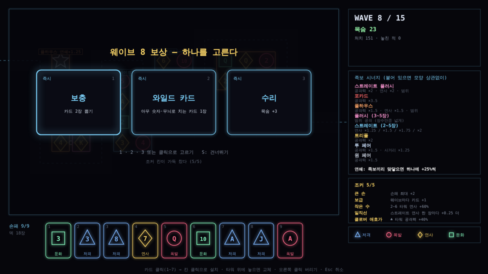

# 포커 디펜스 프로토타입 (가칭) v1.3

카드로 타워를 세우는 디펜스. 핵심 루프만 만든 첫 프로토타입이다. 기획 메모는 [docs/14-poker-defense.md](../../docs/14-poker-defense.md).

- 카드 한 장 = 타워 하나. **무늬 = 공격 방식, 숫자 = 공격력** (2~10, J Q K A = 11~14)
- **상하좌우로 붙어 있는 타워들**이 포커 족보가 되면 시너지 (ㄴ·ㄱ·T자 등 모양 상관없음). 타워 하나는 족보 하나에만 들어간다
- **연쇄**: 족보끼리 맞닿아 있으면 하나의 연쇄. 연쇄에 든 족보 수만큼 공격력 +25%씩 (2개 ×1.25, 3개 ×1.5 ...)
- 웨이브를 막을 때마다 카드 3장 (처음 5장, 손패 최대 7장, 덱 52장)
- 카드를 지금 놓을지, 손에 들고 큰 족보를 노릴지 고른다. 타워 위에 놓으면 교체 (원래 카드는 버려짐)
- 15웨이브, 목숨 20. 5·10·15웨이브는 보스 (방패 거인, 분열 군주, 재생 왕)
- **웨이브를 막을 때마다 보상 3개 중 1개**: 조커(최대 5칸, 판 끝까지 규칙을 바꿈) 또는 즉시 보상
- **길은 판마다 무작위** (왼쪽에서 들어와 오른쪽으로 나가는 지그재그, 길이 34~46칸)
- 족보에 든 칸은 모양대로 테두리, 맞닿은 족보 사이에는 흰 고리(연쇄)

## 무늬 = 공격 방식 (도형)
| 무늬 | 도형 | 공격 |
|---|---|---|
| ♠ | 파란 삼각형 | 저격: 사거리 길고 한 방이 셈 |
| ♥ | 빨간 원 | 폭발: 맞은 자리 주변도 피해 |
| ♦ | 노란 마름모 | 연사: 약하지만 아주 빠름 |
| ♣ | 초록 사각형 | 둔화: 맞은 적이 느려짐 |

## 족보 = 시너지 (붙어 있는 2~5장, 모양·순서 상관없음)
| 족보 | 장수 | 효과 |
|---|---|---|
| 원 페어 | 2 | 공격력 ×1.5 |
| 투 페어 | 4 | 공격력 ×1.5, 사거리 ×1.25 |
| 트리플 | 3 | 공격력 ×2 |
| 스트레이트 | 2~5 | 연사 ×1.25 / ×1.5 / ×1.75 / ×2 (이어진 숫자 2장부터) |
| 플러시 | 3~5 | 범위 공격 (장수가 많을수록 넓게) |
| 풀하우스 | 5 | 공격력 ×1.5, 연사 ×1.5, 범위 |
| 포카드 | 4 | 공격력 ×3.5 |
| 스트레이트 플러시 | 5 | 공격력 ×2, 연사 ×2, 범위 |

붙은 덩어리 안에서 큰 족보부터 겹치지 않게 고른다 (7 7 5 5 5 는 페어+트리플이 아니라 풀하우스). A는 A-2-3, Q-K-A 둘 다 스트레이트.

## 보상: 조커 (18종, 최대 5칸)
| 조커 | 효과 |
|---|---|
| 하트·스페이드·다이아·클로버 애호가 | 그 무늬 타워 공격력 +40% (4종) |
| 연결고리 | 연쇄 보너스 +25% → +45% |
| 쌍둥이 | 원 페어·투 페어 공격력 ×1.5 → ×2 |
| 일직선 | 스트레이트 연사 한 장마다 +0.25 더 |
| 넓은 물결 | 플러시 범위 +0.75칸 |
| 그림 카드 | J·Q·K 타워 공격력 +60% |
| 작은 수 | 2~6 타워 연사 +60% |
| 행운의 7 | 숫자 7 타워 공격력 ×2.5 |
| 큰 손 | 손패 최대 +2 |
| 보급 | 웨이브마다 카드 +1 |
| 재활용 | 카드를 버리면 1장 뽑기 |
| 조준경 | 모든 타워 사거리 +15% |
| 서리 | 둔화 더 강하게, ♣ 주변도 둔화 |
| 연쇄 폭발 | 적 처치 시 주변 적에게 최대 체력 15% 피해 |
| 관통탄 | 적의 방패 무시 |

보상 후보는 조커 2개 + 즉시 보상 1개. 조커 칸이 가득 차면 즉시 보상만 나온다.

| 즉시 보상 | 효과 |
|---|---|
| 와일드 카드 | 아무 숫자·무늬로 치는 카드 1장 (흰 별 타워, 숫자 10 위력) |
| 보충 | 카드 2장 뽑기 |
| 수리 | 목숨 +3 |

## 적
| 적 | 모양 | 특징 | 등장 |
|---|---|---|---|
| 보통 | 원 | | 1웨이브~ |
| 빠름 | 삼각형 | 체력 낮고 빠름, 잔상 | 3~ |
| 방패병 | 원 + 위 막대 | 한 방 피해를 일정량 깎음 (최소 25%). 연사 타워에 강함 | 4~ |
| 탱크 | 육각형 | 체력 높고 느림 | 5~ |
| 분열체 | 겹친 원 두 개 | 죽으면 작은 적 둘로 | 6~ |
| 재생자 | 십자 마름모 | 초당 최대 체력 3% 회복 | 8~ |
| 보스: 방패 거인 | 큰 사각 | 방패 15 | 5 |
| 보스: 분열 군주 | 큰 팔각 | 죽으면 탱크 넷으로 | 10 |
| 보스: 재생 왕 | 큰 육각 | 초당 1.5% 회복 | 15 |

## 조작
| 입력 | 동작 |
|---|---|
| 카드 클릭 / 숫자키 | 카드 고르기 |
| 보상 화면: 1~3 / 클릭 / S | 보상 고르기 / 건너뛰기 |
| 칸 클릭 | 설치 (놓기 전에 생길 족보를 미리 보여 줌) |
| 오른쪽 클릭 (카드) | 버리기 |
| Space / Enter | 웨이브 시작 |
| F | 속도 ×1 / ×2 / ×3 |
| Esc / M | 취소 / 소리 |

## 시험
`test.js`: 족보 판정 14가지, 와일드 카드, 방패·분열·재생, 조커 효과, 보상 후보, 보스 웨이브, 무작위 길, ㄴ자 족보, 연쇄, 큰 족보 우선, 설치·교체, 봇 시험.

| 봇 (10판, 무작위 길, 적 체력 웨이브마다 ×1.45) | 결과 |
|---|---|
| 족보를 생각 + 조커 먼저 고름 | 8판 통과 |
| 족보를 생각 + 보상 아무거나 | 7판 통과 |
| 족보를 생각 + 보상 안 받음 | 전부 실패 (11~13웨이브) |
| 족보를 생각 안 함 + 조커 먼저 | 1판 통과, 대부분 10~12웨이브 실패 |

족보도, 보상도 둘 다 챙겨야 깬다.

족보를 생각하느냐에 따라 결과가 갈린다. 봇은 카드를 아끼지 않고 바로 놓는다.
효과음은 테트리스 포커와 같은 합성음(`../tetris-poker/sounds.js`).
