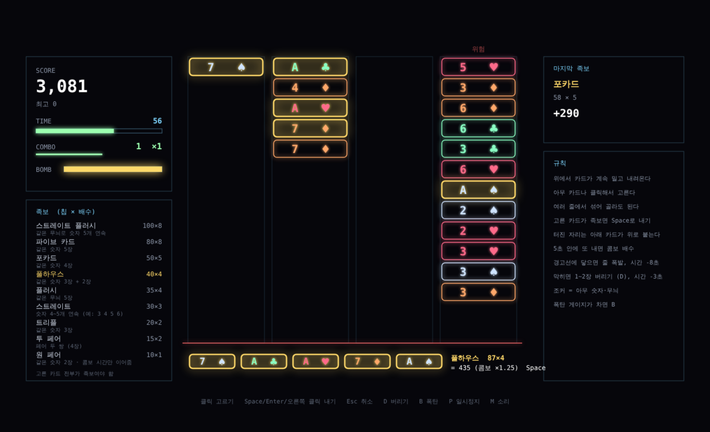

# 스택 포커 프로토타입 (가제)

액션퍼즐패밀리의 줄 쌓기 모드를 참고해 블록 색 맞추기를 **포커 족보**로 바꾼 퍼즐 (v2).

- 카드 4줄이 위에 매달려 있고, 위에서 새 카드가 계속 밀고 내려온다 (갈수록 빨라짐)
- **내려오는 카드를 클릭해 골라** 족보를 만든다. 어느 줄이든 섞어서 골라도 된다 (최대 5장)
- 고른 카드 전부가 족보면 Space(또는 오른쪽 클릭)로 내서 터뜨린다
- 원 페어도 된다. 대신 점수가 가장 낮고, 콤보 단계는 안 올리고 콤보 시간만 이어준다
- 터진 자리는 아래 카드가 위로 붙는다
- 5초 안에 다음 족보를 내면 콤보 배수 (×1.25씩, 최대 ×3)
- 줄이 경고선에 닿으면 그 줄이 폭발해 전부 사라지고 시간 -8초
- 막히면 카드 1~2장 버리기 (D, 시간 -3초), 폭탄 게이지가 차면 B: 모든 줄 맨 아래 2장 폭파
- 조커(가끔 나옴)는 아무 숫자·무늬로 친다
- 90초 동안 최대 점수 (최고 기록은 브라우저에 저장)

## 족보
| 족보 | 조건 | 칩 × 배수 |
|---|---|---|
| 스트레이트 플러시 | 같은 무늬로 숫자 5개 연속 | 100 × 8 |
| 파이브 카드 | 같은 숫자 5장 | 80 × 8 |
| 포카드 | 같은 숫자 4장 | 50 × 5 |
| 풀하우스 | 같은 숫자 3장 + 2장 | 40 × 4 |
| 플러시 | 같은 무늬 5장 | 35 × 4 |
| 스트레이트 | 숫자 4~5개 연속 | 30 × 3 |
| 트리플 | 같은 숫자 3장 | 20 × 2 |
| 투 페어 | 페어 두 쌍 (4장) | 15 × 2 |
| 원 페어 | 같은 숫자 2장 (콤보 시간만 이어줌) | 10 × 1 |

점수 = (기본 칩 + 카드 숫자 합, A는 11, 조커 10) × 배수 × 콤보. 덱은 A~7 × 4무늬 × 2벌.

## 조작
| 입력 | 동작 |
|---|---|
| 카드 클릭 | 고르기 / 다시 누르면 빼기 |
| Space / Enter / 오른쪽 클릭 | 족보 내기 |
| Esc | 선택 취소 |
| D | 고른 1~2장 버리기 |
| B | 폭탄 |
| P / M | 일시정지 / 소리 |

## 시험
`test.js`: 족보 판정 13가지 (조커, 남는 카드 있으면 안 됨, A는 1), 고르기·내기·버리기, 원 페어 콤보 규칙, 줄 폭발, 봇 시험.
봇은 각 줄 아래쪽 6장에서 가장 좋은 족보를 찾는다. "족보 찾는 시간"을 바꿔 가며 사람 속도를 흉내 낸다 (클릭 1번 0.3초).

| 족보 하나 찾는 시간 | 평균 점수 | 낸 족보 | 최대 콤보 | 줄 폭발 |
|---|---|---|---|---|
| 2초 (빠른 사람) | 44,036 | 24.6 | 23.6 | 0.4 |
| 3초 | 30,453 | 16.6 | 13.1 | 1.5 |
| 4초 (느긋한 사람) | 8,687 | 10.6 | 1 | 2.5 |

5초 콤보 창 안에 족보를 찾느냐가 점수를 크게 가른다.

이전 버전(v1: 아래에서 카드를 쏘아 3줄 맨 아래로 족보 맞추기)은 git 기록에 남아 있다.
효과음은 테트리스 포커와 같은 합성음(`../tetris-poker/sounds.js`).
