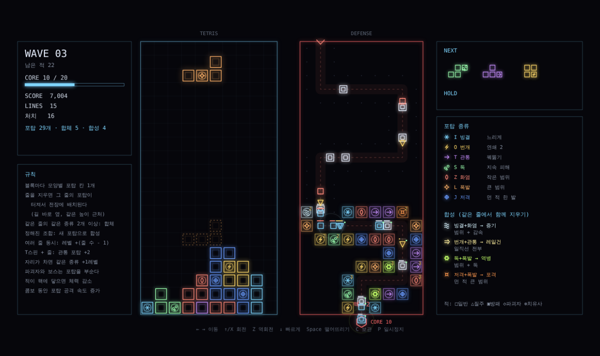

# 테트리스 디펜스 웹 프로토타입

브라우저에서 `index.html`을 열면 바로 플레이할 수 있다. 외부 라이브러리 없음.

온라인 플레이: https://claude.ai/artifact/6hCTn3v8ZHNnvQKbCUy8eP (비공개. 공유 메뉴에서 공유해야 다른 사람이 열 수 있음)

터치 화면에서는 아래쪽에 조작 버튼이 나타난다.

## 조작
| 키 | 동작 |
|---|---|
| ← → | 이동 |
| ↑ / X | 회전 |
| Z | 역회전 |
| ↓ | 빠르게 내리기 |
| Space | 즉시 떨어뜨리기 |
| C / Shift | 보관 |
| P | 일시정지 |
| R | 게임 오버 후 다시 시작 |

## 구현된 규칙
- 테트리스: 7종 블록(7-bag), 회전 보정, 착지 그림자, 다음 3개, 보관, 고정 지연
- 적 8종: 낙하병, 낙하산, 폭탄, 굴착, 유령, 방패병, 거미, 보스. 등장 전 경고. 방패병과 거미는 화면당 합쳐서 2마리까지
- 처치: 깔아뭉개기(방패병, 보스, 유령 제외), 포탑
- 모양별 포탑: 모든 블록에 포탑 칸 1개. I 빙결, O 번개, T 관통, S 독, Z 화염, L 폭발, J 저격. 항상 사격
- 합체: 지운 줄의 포탑은 같은 모양끼리 레벨 합산(여러 줄이면 보너스) → 그 모양의 다음 블록에 실림 (최대 9)
- T 스핀은 다음 T 포탑 +2, 판 비우기는 모든 대기 레벨 +2
- 1칸 구멍 바닥 포탑은 함정 (3배 피해)
- 포탑 체력: 적이 붙어서 공격하면 부서진다
- 깔아뭉개기 5회마다 무쇠 블록 (적이 갉아 먹지 못함)
- 판 끝: 블록이 천장에 닿거나 핵 체력 0

## 자동 시험
`bottest.js`는 휴리스틱 봇이 블록을 쌓으며 게임 시간을 빠르게 돌려 오류와 진행 상황을 확인한다.

| 시험 | 결과 (2026-11-05) |
|---|---|
| 일반 진행 | 161초, 5웨이브, 처치 60, 오류 없음 |
| 적 8종 동시 소환 | 142초, 5웨이브, 처치 61, 오류 없음 |
| 포탑 재설계 후 봇 진행 (11-07) | 4~5웨이브, 합체 16~21회, 오류 없음 |
| 모양별 포탑 봇 진행 (11-07) | 5웨이브, 처치 123, 합체 24회, 핵 19/20, 오류 없음 |
| 같은 모양 합체 단위 시험 (11-07) | I 2개 + Z 1개 → 다음 I 블록 Lv2, Z Lv1 대기 |

시험 중 고친 버그:
- 줄을 지울 때 합체 고리 효과의 반지름이 음수가 되어 화면 그리기 오류로 게임이 멈추던 문제 (11-07). 반지름을 보정하고, 한 프레임에서 오류가 나도 루프가 계속 돌게 했으며, 봇 시험이 화면 그리기까지 거치도록 바꿈
- 떨어지는 중인 보스와 방패병이 블록 생성 위치를 막아 시작하자마자 지는 문제. 단단한 적은 착지한 뒤에만 블록을 막도록 수정.
