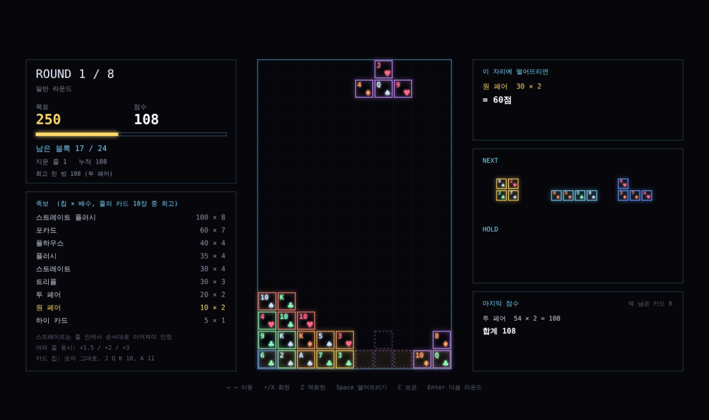
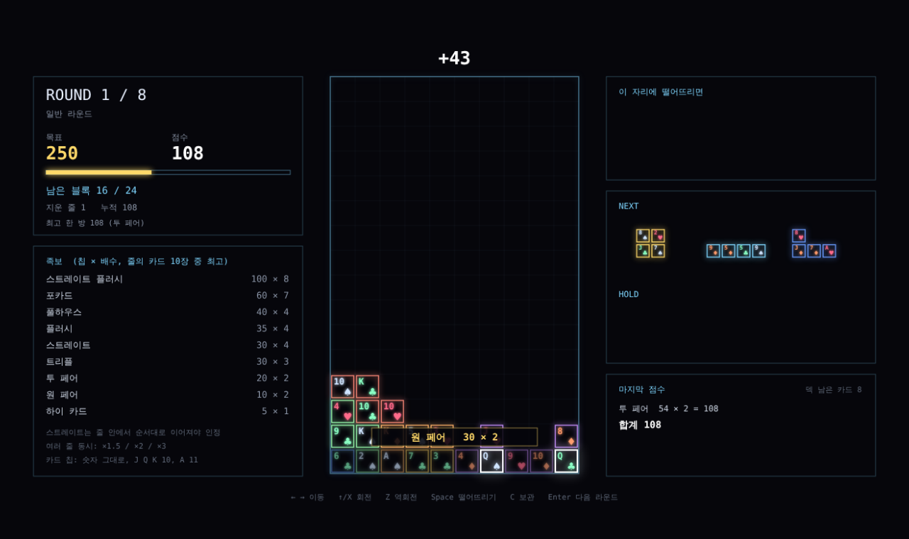

# 테트리스 포커 프로토타입

블록의 칸마다 카드가 붙어 있는 턴 방식 테트리스. 한 줄을 채워 지우면 그 줄의 카드 10장으로 포커 족보 점수를 얻는다.
브라우저에서 `index.html`을 열면 바로 플레이할 수 있다. 외부 라이브러리 없음.

| 미리보기 | 점수 계산 순간 |
|---|---|
|  |  |

## 규칙
- 블록은 저절로 떨어지지 않는다 (턴 방식). 자리를 고르고 Space로 떨어뜨린다
- 블록의 4칸마다 덱(52장)에서 뽑은 카드. 회전하면 카드도 함께 돈다
- 한 줄을 지우면 그 줄의 카드 10장 중 가장 높은 족보로 점수: (족보 기본 칩 + 족보를 이룬 카드 칩) × 배수
- 스트레이트는 줄 안에서 왼쪽부터 순서대로 이어져야 인정 (오름차순, 내림차순, A-2-3-4-5 가능). 페어, 플러시 등은 위치 무관
- 여러 줄 동시: 합계 ×1.5 / ×2 / ×3
- 떨어뜨리기 전에 착지 위치, 지워질 줄, 예상 족보와 점수를 미리 보여 준다
- 라운드마다 블록 24개 안에 목표 점수를 넘기면 통과. 블록이 천장에 닿거나 블록을 다 쓰면 실패

| 족보 | 칩 × 배수 |
|---|---|
| 스트레이트 플러시 | 100 × 8 |
| 포카드 | 60 × 7 |
| 풀하우스 | 40 × 4 |
| 플러시 | 35 × 4 |
| 스트레이트 | 30 × 4 |
| 트리플 | 30 × 3 |
| 투 페어 | 20 × 2 |
| 원 페어 | 10 × 2 |
| 하이 카드 | 5 × 1 |

| 라운드 | 목표 | 보스 |
|---|---|---|
| 1 | 250 | |
| 2 | 400 | |
| 3 | 600 | 보관 금지 |
| 4 | 800 | |
| 5 | 1,000 | |
| 6 | 1,300 | 빨간 카드(♥♦)는 칩 0 |
| 7 | 1,600 | |
| 8 | 2,000 | 한 줄만 지우면 점수 0 |

## 조작
| 키 | 동작 |
|---|---|
| ← → | 이동 |
| ↑ / X | 회전 |
| Z | 역회전 |
| Space | 떨어뜨리기 |
| C / Shift | 보관 |
| Enter | 다음 라운드 |
| R | 처음부터 |

## 자동 시험
| 스크립트 | 내용 |
|---|---|
| `handtest.js` | 족보 판정 11가지, 여러 줄 배수, 빨간 카드 보스 규칙 |
| `bottest.js` | 봇이 모든 자리를 따져 예상 점수와 쌓인 모양으로 놓으며 진행. 도달 라운드 분포 |

| 결과 (2026-11-07, 봇 20판) | |
|---|---|
| 족보 시험 | 11가지 모두 통과 |
| 도달 라운드 | 5: 1판, 6: 11판, 7: 4판, 8: 3판, 전부 클리어: 1판 |
| 실패 원인 | 모두 "블록을 다 썼는데 목표 미달" (천장 도달 없음) |

처음에는 3라운드 보스가 회전 금지였는데 봇 20판 중 18판이 3라운드에서 막혀 보관 금지로 바꿨다.

## 다음 단계 후보
- 라운드 사이 상점: 조커(규칙을 비트는 패시브), 카드 강화와 삭제
- 조커 예시: 빨간 카드 배수 +2, T 블록 카드 두 번 계산, 세로로 같은 숫자면 보너스
